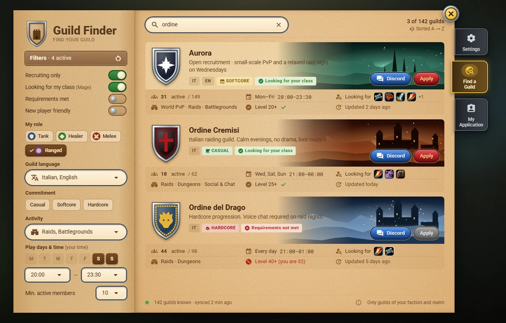

<div align="center">

# Azeroth Guild Finder

**Trova la tua gilda senza uscire dal gioco.**<br>
Un cercagilde per **World of Warcraft: Forever**: cerca le gilde per lingua, attività, orari e classi cercate, e candidati con un clic. Il Guild Master pubblica l'annuncio, gli ufficiali gestiscono le candidature.

[](https://github.com/Finland6738/azeroth-guild-finder/actions/workflows/ci.yml)
[](LICENSE)


> 🇬🇧 [English version](README.md)



*Bozzetto di progetto, non una schermata del gioco: l'addon non è ancora stato provato nel gioco.*

</div>

> **Stato: in sviluppo, non ancora provato nel gioco.** Specifiche, decisioni e bozzetti sono pronti, e le tappe M1 e M2 (sincronizzazione del catalogo, finestra principale, Trova gilda con ricerca e filtri, pagina della gilda) e i primi tre passi di M3 (l'annuncio del Guild Master e la sua sincronizzazione nella gilda, la struttura dell'editor dell'annuncio con il suo elenco di controllo, i passi Identity e About) sono scritte e collaudate offline su un client simulato e un simulatore di rete; nessuno le ha ancora eseguite in WoW Forever, quindi nulla è confermato in gioco. Le verifiche M0 e quelle in gioco aspettano il proprietario (elenchi [M2](docs/checklists/M2.md) e [M3](docs/checklists/M3.md), in inglese). Non c'è ancora niente da scaricare. Segui la [roadmap](ROADMAP.md) e gli [Annunci](https://github.com/Finland6738/azeroth-guild-finder/discussions/categories/announcements).

## Funzioni

**Per chi cerca gilda**

- **Una sola vista di ricerca**: nome della gilda più filtri per ruolo (Tank, Healer, Melee DPS, Ranged DPS), lingua, impegno (Casual, Softcore, Hardcore), attività, giorni e orari (nel *tuo* fuso), membri attivi, requisiti e gilde aperte ai nuovi giocatori.
- **Sempre in ordine alfabetico**: niente posizioni a pagamento, nessun vantaggio a chi ripubblica di continuo.
- **Una pagina della gilda chiara**: prima le classi e i ruoli **cercati**, poi descrizione, attività, orari, statistiche oneste (personaggi attivi e giocatori unici negli ultimi 7 giorni) e requisiti confrontati con il tuo personaggio.
- **Candidatura con un clic**: nome, classe e livello arrivano agli ufficiali; vedi lo stato della candidatura e, se accettata, ricevi il normale invito in gilda.
- **Contatti**: il link Discord della gilda pronto da copiare e i pulsanti per sussurrare ai contatti.

**Per i Guild Master**

- **Pubblica un annuncio** in circa tre minuti, con un editor guidato e l'anteprima dal vivo; il nome della gilda viene dal gioco.
- **Stemma dal tuo tabarro** (icona, bordo, colori), oppure creane uno con i pezzi del tabarro del gioco.
- Indica **classi e ruoli che cerchi**, l'impegno, fino a tre attività, gli orari e i requisiti.

**Per gli ufficiali**

- Una **casella delle candidature** condivisa, con Invita, Rifiuta e Sussurra, sincronizzata tra gli ufficiali.
- Un'**icona di notifica** spostabile, con il numero delle candidature e una lista rapida.

## Come funziona

Non c'è un server. Ogni installazione conserva gli annunci che ha visto e li condivide con le altre in un canale di chat nascosto. Sono i membri della gilda la fonte del suo annuncio: il Guild Master lo scrive, il canale di gilda lo distribuisce ai membri e ogni membro online lo ripete. Le candidature vanno direttamente a un ufficiale online. Dettagli: [ADR 0001](docs/adr/0001-client-only-addon-peer-to-peer-catalog.md) e la [specifica del protocollo](docs/specs/SPEC-02-network-protocol.md).

## Requisiti e installazione

- **World of Warcraft: Forever** (Interface `16001`); le librerie (Ace3, LibDBIcon) sono incluse.
- Alla prima versione: scarica da **CurseForge** o dalle **[GitHub Releases](https://github.com/Finland6738/azeroth-guild-finder/releases)**, estrai la cartella `AzerothGuildFinder` in `World of Warcraft/_forever_/Interface/AddOns/` e riavvia il gioco (o `/reload`).

## Comandi

| Comando | Cosa fa |
|---|---|
| `/gf` | Apre o chiude Guild Finder (anche dal pulsante sulla minimappa o con un tasto) |
| `/gf notify` | Mostra o nasconde l'icona di notifica delle candidature (Guild Master e ufficiali) |
| `/gf reset` | Ripristina la posizione della finestra |
| `/gf scale 60` … `/gf scale 140` | Imposta la dimensione della finestra (dal 60 % al 140 %) |
| `/gf debug` | Diagnostica: cosa il client permette all'addon |

## Privacy

- Pubblici: solo gli annunci che i Guild Master scelgono di pubblicare, con statistiche **aggregate**.
- Nella tua gilda: un token anonimo e il **numero** dei tuoi personaggi attivi, per stimare i giocatori unici (si può disattivare).
- Una candidatura arriva solo al Guild Master e agli ufficiali della gilda.
- Nessun server esterno, nessuna telemetria, nessuna connessione a internet.

## Sviluppo

```
python -I -X utf8 tools/fetch_libs.py      # scarica in AzerothGuildFinder/Libs/ le librerie fissate in .pkgmeta
python -I -X utf8 tools/install_addon.py   # copia l'addon nella cartella AddOns indicata in tools/local.ini
python -m pip install lupa==2.8            # una volta sola
python -X utf8 Tests/run_tests.py          # test offline: Lua 5.1 su un client WoW finto, con Ace3 vero
```

In gioco: `/reload`, poi `/gf help`. Configurazione di `tools/local.ini`: [tools/local.example.ini](tools/local.example.ini). Controlli e test: [CONTRIBUTING](CONTRIBUTING.md#4-checks-and-tests).

## Documentazione

- [Manuale (wiki)](https://github.com/Finland6738/azeroth-guild-finder/wiki), generato da [`docs/wiki/`](docs/wiki/Home.md).
- [Specifiche](docs/specs/README.md) e [bozzetti](docs/specs/mockups/img/).
- [Decisioni (ADR)](docs/adr/README.md) · [Changelog](CHANGELOG.md) · [Roadmap](ROADMAP.md) · [Contribuire](CONTRIBUTING.md).

## Supporta il progetto

Se il progetto ti piace puoi sostenerlo su [Ko-fi](https://ko-fi.com/finland6738).

## Licenza

[GNU General Public License v3.0](LICENSE). Librerie e font inclusi mantengono le loro licenze: Ace3 e LibDBIcon (nelle cartelle di `AzerothGuildFinder/Libs/`), e **Roboto** e **Roboto Mono** di The Roboto Project Authors e The Roboto Mono Project Authors, sotto la [SIL Open Font License 1.1](AzerothGuildFinder/Media/Fonts/OFL-Roboto.txt).

*Azeroth Guild Finder è un addon amatoriale, non affiliato né approvato da Blizzard Entertainment. World of Warcraft e Warcraft sono marchi di Blizzard Entertainment, Inc.*
