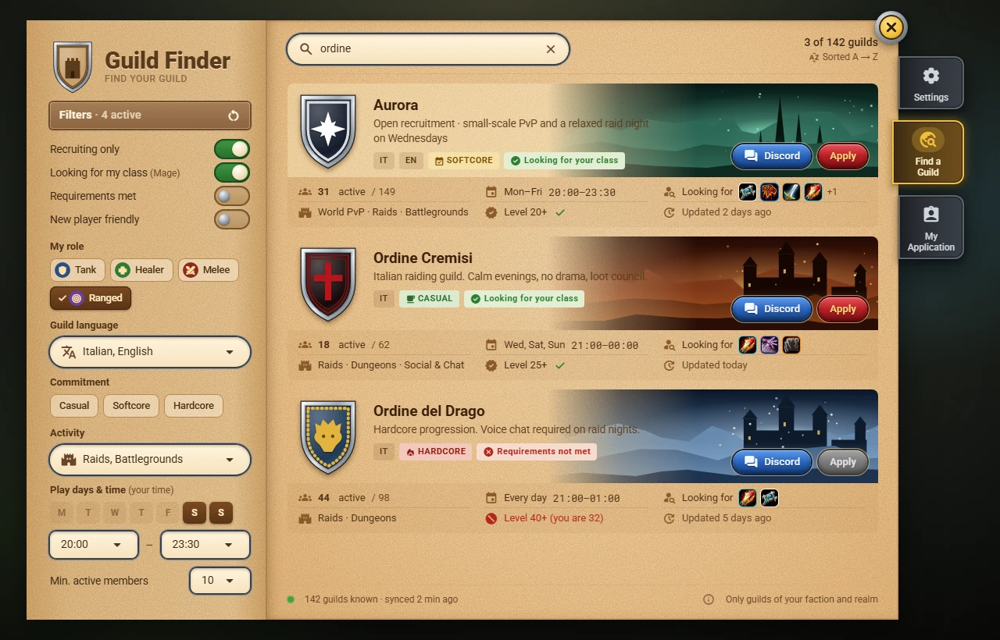
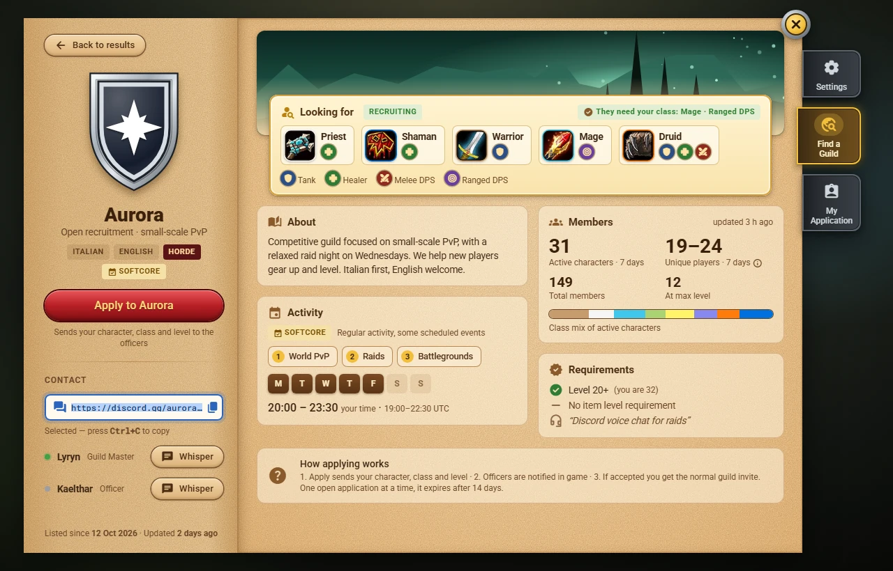
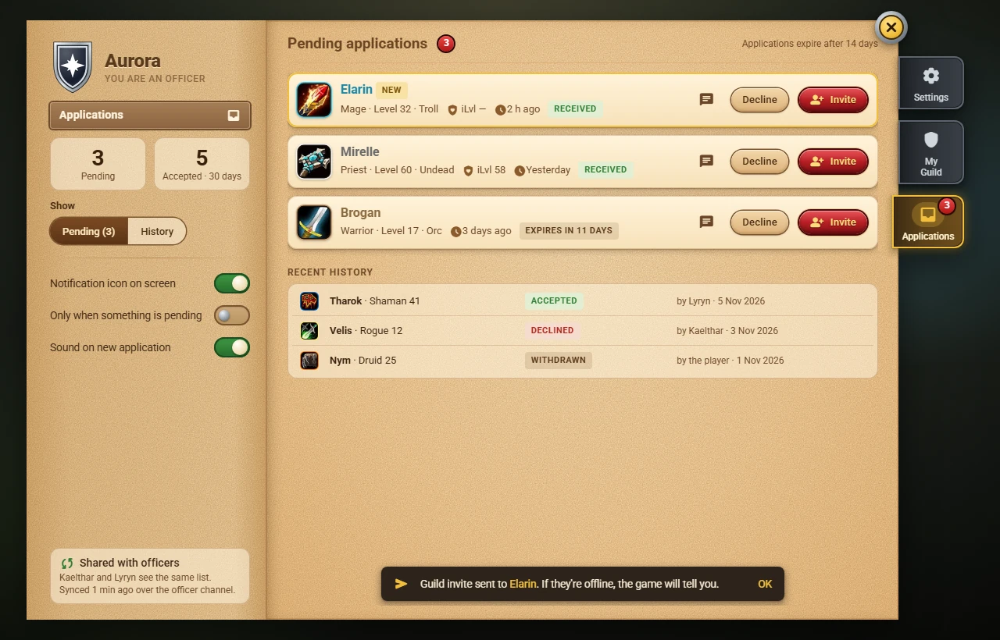
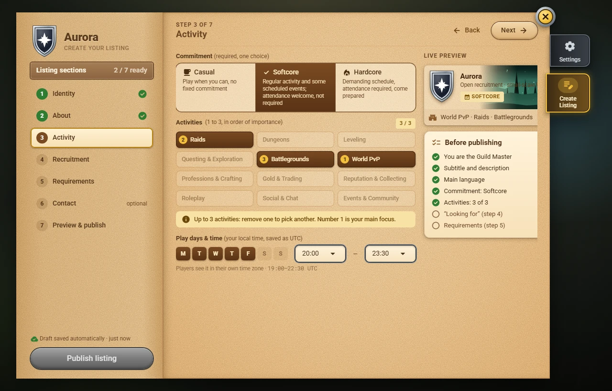
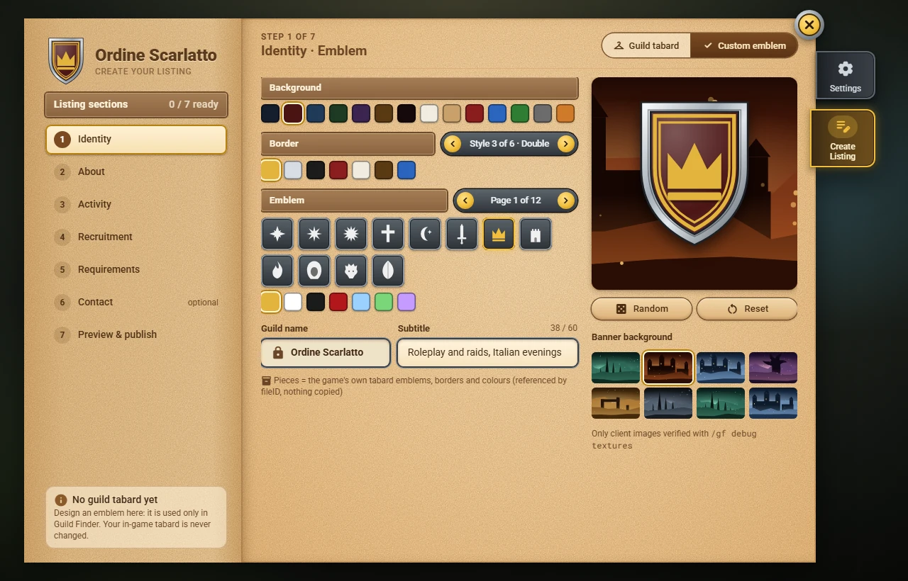

<div align="center">

# Azeroth Guild Finder

**Find your guild without leaving the game.**<br>
A guild finder for **World of Warcraft: Forever**: browse guilds by language, activity, schedule and the classes they need, and apply with one click. Guild Masters publish a listing, officers manage the applications.

[](https://github.com/Finland6738/azeroth-guild-finder/actions/workflows/ci.yml)
[](LICENSE)


> 🇮🇹 [Versione italiana](README.it.md)



*Design mockup, not an in-game screenshot: the addon is still being designed.*

</div>

> **Status: design phase.** The specification, the decisions and the mockups are done; development starts with milestone M0 (checks in the real client). There is no download yet. Follow the [roadmap](ROADMAP.md) and the [Announcements](https://github.com/Finland6738/azeroth-guild-finder/discussions/categories/announcements).

## Contents

- [Features](#features)
- [Screenshots](#screenshots)
- [How it works](#how-it-works)
- [Requirements](#requirements)
- [Installation](#installation)
- [Commands](#commands)
- [Privacy and data](#privacy-and-data)
- [Project status](#project-status)
- [Documentation](#documentation)
- [Contributing](#contributing)
- [Support the project](#support-the-project)
- [License](#license)

## Features

**For players without a guild**

- **One search view**: guild name search plus filters for role (Tank, Healer, Melee DPS, Ranged DPS), language, commitment (Casual, Softcore, Hardcore), activities, play days and hours (in *your* time zone), active members, requirements and new-player friendly guilds.
- **Always alphabetical**: no paid placement, no reward for posting again and again.
- **A clear guild page**: the classes and roles the guild is **looking for** come first, then the description, activities, schedule, honest statistics (active characters and unique players in the last 7 days) and the requirements checked against your character.
- **Apply with one click**: your name, class and level go to the officers; you see the status of your application and get the normal guild invite if accepted.
- **Contacts**: the guild's Discord link ready to copy, and whisper buttons for the contacts.

**For Guild Masters**

- **Publish a listing** in about three minutes with a guided editor and a live preview; the guild name comes from the game.
- **Emblem from your tabard** (icon, border, colours), or design one from the game's tabard pieces if you have none.
- Choose the **classes and roles you need**, your commitment, up to three activities, your schedule and your requirements.

**For officers**

- A shared **applications inbox** with Invite, Decline and Whisper, kept in sync between officers.
- A movable **notification icon** with a badge and a quick list.

## Screenshots

| Guild page | Applications |
|---|---|
|  |  |
| **Listing editor** | **Emblem designer** |
|  |  |

All screens: [docs/specs/mockups](docs/specs/README.md).

## How it works

There is no server. Every installation keeps a catalog of the listings it has seen and shares it with the others over a hidden chat channel. A guild's own members are the source of its listing: the Guild Master writes it, the guild channel spreads it to the members, and any member online announces it. Applications go straight to an online officer. Details: [ADR 0001](docs/adr/0001-client-only-addon-peer-to-peer-catalog.md) and the [protocol specification](docs/specs/SPEC-02-network-protocol.md).

## Requirements

- **World of Warcraft: Forever** (Interface `16001`).
- No other addon is required; the libraries it uses (Ace3, LibDBIcon) are included.

## Installation

When the first version is released:

1. Download it from **CurseForge** or from the **[GitHub Releases](https://github.com/Finland6738/azeroth-guild-finder/releases)**.
2. Extract the `AzerothGuildFinder` folder into `World of Warcraft/_forever_/Interface/AddOns/`.
3. Restart the game, or type `/reload`.

Step-by-step guide: [the wiki](https://github.com/Finland6738/azeroth-guild-finder/wiki).

## Commands

| Command | What it does |
|---|---|
| `/gf` | Opens or closes Guild Finder (also with the minimap button or a key binding) |
| `/gf notify` | Shows or hides the applications notification icon (Guild Masters and officers) |
| `/gf reset` | Resets the window position |
| `/gf scale 60` to `/gf scale 140` | Sets the window size (60 % to 140 %) |
| `/gf debug` | Diagnostics: what your client allows the addon to do |

## Privacy and data

- Public: only the guild listings that Guild Masters choose to publish, with **aggregate** statistics.
- Inside your guild: an anonymous token and the **number** of your active characters, to estimate unique players (you can switch it off).
- An application goes only to the guild's Guild Master and officers.
- No external server, no telemetry, no internet connection.

## Project status

| Milestone | Content | Status |
|---|---|---|
| Design | Specification, decisions, mockups | ✅ done |
| M0 | Checks in the real client (spike) | ⏳ next |
| M1 | Addon skeleton, transport, codec, tests | planned |
| M2 | Catalog sync, Find a Guild | planned |
| M3 | Listing editor, guild page, emblems, statistics | planned |
| M4 | Applications and notifications | planned |
| M5 | Polish, release checklist, packaging | planned |

Full plan: [ROADMAP.md](ROADMAP.md).

## Development

```
python -I -X utf8 tools/fetch_libs.py      # downloads the libraries pinned in .pkgmeta into AzerothGuildFinder/Libs/
python -I -X utf8 tools/install_addon.py   # copies the addon into the AddOns folder set in tools/local.ini
python -m pip install lupa==2.8            # once
python -X utf8 Tests/run_tests.py          # offline tests: Lua 5.1 on a mock WoW client, with the real Ace3
```

In game: `/reload`, then `/gf help`. Setup of `tools/local.ini`: [tools/local.example.ini](tools/local.example.ini). Checks and tests: [CONTRIBUTING](CONTRIBUTING.md#4-checks-and-tests).

## Documentation

- [User manual (wiki)](https://github.com/Finland6738/azeroth-guild-finder/wiki), generated from [`docs/wiki/`](docs/wiki/Home.md).
- [Specification](docs/specs/README.md) (Italian) and [mockups](docs/specs/mockups/img/).
- [Architecture decisions (ADRs)](docs/adr/README.md).
- [Changelog](CHANGELOG.md) · [Roadmap](ROADMAP.md) · [Contributing](CONTRIBUTING.md).

## Contributing

Ideas and feedback are welcome in the [Feedback discussions](https://github.com/Finland6738/azeroth-guild-finder/discussions/categories/feedback). Bugs go in the [issues](https://github.com/Finland6738/azeroth-guild-finder/issues/new/choose). Before a pull request, read [CONTRIBUTING.md](CONTRIBUTING.md) and the [Code of Conduct](CODE_OF_CONDUCT.md).

## Support the project

If you like the project you can support it on [Ko-fi](https://ko-fi.com/finland6738).

## License

[GNU General Public License v3.0](LICENSE). Included libraries and fonts keep their own licences.

*Azeroth Guild Finder is a fan-made addon, not affiliated with or endorsed by Blizzard Entertainment. World of Warcraft and Warcraft are trademarks of Blizzard Entertainment, Inc.*
