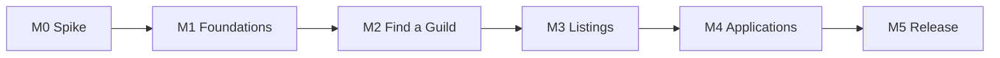

# Development roadmap

One file per milestone; each file lists the **development steps** of that milestone. A step is one branch and one pull request, shipped automatically with `tools/ship_step.py` when its checks are green ([ADR 0013](../adr/0013-git-flow-and-automated-shipping.md)). The short overview is in [ROADMAP.md](../../ROADMAP.md); the behaviour every step implements is in the [specification](../specs/README.md).

| Milestone | File | Goal | Steps | Needs the real client |
|---|---|---|---|---|
| **M0** | [M0-spike.md](M0-spike.md) | Answer the open technical questions in the real client before writing the addon | 7 | yes, the whole milestone |
| **M1** | [M1-foundations.md](M1-foundations.md) | Addon skeleton, test harness, Compat, saved data, codec, transport, channel | 8 | final check only |
| **M2** | [M2-find-a-guild.md](M2-find-a-guild.md) | Catalog sync, the main window, Find a Guild and the guild page | 8 | final check only |
| **M3** | [M3-listings.md](M3-listings.md) | Listing editor, guild sync, emblems, statistics, My Guild | 8 | final check only |
| **M4** | [M4-applications.md](M4-applications.md) | Applications, officer inbox, notification icon | 6 | final check only |
| **M5** | [M5-release.md](M5-release.md) | Settings, polish, packaging, beta and v1.0.0 | 7 | beta and release checklist |
| V2 | [V2-backlog.md](V2-backlog.md) | Ideas after v1.0.0 | — | — |

## Order and dependencies



> **M0.7 deferred** until the owner's in-game results; M1+ proceed on the specification's assumptions and will be revised after M0.7.

M0 can change the plan: if Blizzard's Club Finder works on Forever (check S1), M1–M4 are revised before they start.

## How a step is written

```
### M<N>.<k> — Title
- Branch:      step/m<N>-<k>-<short-name>
- Depends on:  previous steps
- Spec:        the sections it implements
- Scope:       what it creates or changes
- Done when:   acceptance criteria (checkboxes)
- Tests:       offline tests that must exist and pass
- Docs:        what to update in the same pull request
- Real client: what only the game can confirm (listed in the PR as "not verified")
```

## Definition of done (every step)

- [ ] The acceptance criteria of the step are met.
- [ ] `python -I -X utf8 tools/check_docs.py` and, from M1.2 on, `python -I -X utf8 Tests/run_tests.py` pass locally and in CI.
- [ ] `CHANGELOG.md` ("Unreleased"), the affected specs and ADRs, both READMEs when features or status change, and `docs/wiki/` for anything a user can see are updated in the same pull request.
- [ ] The pull request lists what was **not** verified in the real client.
- [ ] No personal data; every new API is checked against the Forever dump and guarded by Compat.
- [ ] The step's checkboxes in its milestone file are ticked in the same pull request.
