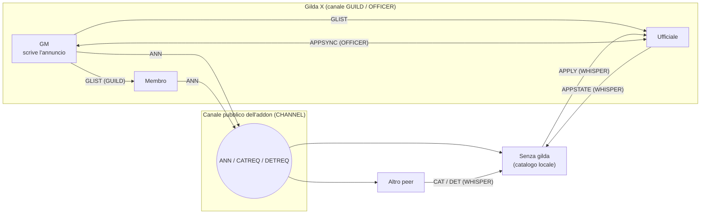

# SPEC-01: Piattaforma e architettura

## 1. Client di riferimento (verificato il 2026-11-08)

| Fatto | Valore | Fonte |
|---|---|---|
| Prodotto | `wowf` (WoW Forever), regione EU | `<cartella di WoW>\.build.info` |
| Versione | `1.60.1.70862` | `.build.info` |
| Interface del TOC | `16001` | TOC degli addon installati in `_forever_\Interface\AddOns` |
| Progetto | `WOW_PROJECT_ID == WOW_PROJECT_CAMELOT` | ThreatClassic2 `core.lua:76`, totalRP3 `Globals.lua:78` |
| Motore | client moderno (Edit Mode, `Settings`, `C_EncodingUtil`, `C_ChatInfo.InChatMessagingLockdown`, AddOn Restrictions) | dump API, log del client |
| Messaggi degli addon nei canali personalizzati | **funzionano** su Forever (totalRP3 usa `ChannelBroadcasts` su CAMELOT; OneForAll condivide i dati in un canale) | sorgenti degli addon installati |
| Canali **temporanei** | il server **rifiuta** i messaggi degli addon (esito 7, `InvalidChannel`) | commento in OneForAll `ProfessionGuild.lua`, osservato il 05.11.2026 |
| Personaggi di livello basso | il server può **rifiutare l'invio** nel canale (esito 7) | stesso commento di OneForAll |
| Canali abbandonati | `/leave` può non funzionare; il gioco può conservare i canali vecchi | OneForAll `LeaveStaleChannels` |
| Dump delle API | build 70170, 6598 funzioni, nella copia locale `..\WoW-Addons\docs\api.json` | come nell'ADR 0010 di azeroth-unspoken |

API rilevanti **presenti nel dump**: `C_ChatInfo.SendAddonMessage` (restituisce `SendAddonMessageResult`), `C_ChatInfo.RegisterAddonMessagePrefix`, `C_ChatInfo.InChatMessagingLockdown`, `C_ChatInfo.AreOutgoingAddonChatMessagesRestricted`, `C_GuildInfo.IsGuildOfficer`, `C_GuildInfo.GetGuildTabardInfo`, `C_GuildInfo.Invite`, `C_GuildInfo.GuildRoster`, `C_GuildInfo.GuildControlGetRankFlags`, `IsGuildLeader`, `IsInGuild`, `GetServerTime`, `C_Club.GetGuildClubId` / `GetMemberInfo` (`ClubMemberInfo` con `lastOnline*`, `level`, `classID`, `guid`), `C_EncodingUtil.SerializeCBOR/DeserializeCBOR/CompressString/DecompressString/EncodeBase/DecodeBase`, `C_ClubFinder.*`.

API **[verificare]** (globali storici, assenti dal dump ma usate da addon installati su Forever): `GetGuildInfo`, `GetNumGuildMembers`, `GetGuildRosterInfo`, `GetGuildRosterLastOnline`, `JoinChannelByName`, `GetChannelName`, `GetChannelList`, `LeaveChannelByName`, `ChatFrame_RemoveChannel`, `ChatFrame_AddMessageEventFilter`, `GetAverageItemLevel`, `GetMaxPlayerLevel`.

> **Da verificare subito: `C_ClubFinder`.** Il client contiene le API del Guild & Community Finder di Blizzard. Se `C_ClubFinder.IsEnabled()` restituisce `true` su Forever, esisterebbe già un catalogo **lato server** utilizzabile dall'addon, e l'architettura cambierebbe in meglio. È il primo punto dello spike ([SPEC-09 §1](SPEC-09-quality-release.md#1-spike-tecnico-m0)). Questa specifica presume che **non** sia attivo.

## 2. Architettura: catalogo peer-to-peer

Senza un server, il catalogo vive **in tutti i client** che usano l'addon. Ogni client:

1. salva il catalogo nelle SavedVariables (così è subito disponibile al login);
2. lo aggiorna ascoltando un **canale personalizzato nascosto** comune a tutti gli utenti dell'addon;
3. chiede ai peer quello che gli manca quando entra nel canale, e risponde alle richieste degli altri.

Le **fonti autorevoli** di un annuncio sono i membri della gilda stessa: il GM lo scrive, lo diffonde ai membri attraverso il canale `GUILD` (consegnato dal server **solo** ai membri della gilda) e ogni membro con l'addon lo ripubblica nel canale pubblico. Così l'annuncio resta visibile anche quando il GM è offline.



Protocollo completo in [SPEC-02](SPEC-02-network-protocol.md).

### Conseguenze accettate (D2)

- Un annuncio è visibile solo se almeno un client lo ha in memoria. Le gilde i cui membri non usano l'addon non compaiono.
- Al primo avvio (catalogo vuoto) la lista si riempie in pochi secondi o minuti, a seconda di quanti peer sono online.
- I dati non si possono garantire come su un server: l'integrità è "ragionevole", non crittografica ([SPEC-02 §8](SPEC-02-network-protocol.md#8-integrità-e-limiti-del-modello-p2p)).

## 3. Moduli

Struttura a moduli isolati con un bus di eventi interno, come in azeroth-unspoken (ADR 0014). Ogni modulo ha una responsabilità sola e si può testare offline.

| Modulo | Responsabilità |
|---|---|
| `Core/Compat` | accesso difensivo alle API (pcall, controllo dell'esistenza, valori segreti), verifica delle funzionalità con `/gf debug` |
| `Core/Config` | SavedVariables, versioni dello schema, migrazioni, valori predefiniti, validazione |
| `Core/Bus` | eventi interni (`CATALOG_UPDATED`, `ROLE_CHANGED`, `APPLICATION_CHANGED`…) |
| `Core/Role` | ruolo del giocatore (senza gilda / membro / ufficiale / GM) e pannelli visibili |
| `Core/Normalize` | chiave di ordinamento e di ricerca dei nomi (D19), funzioni di hash |
| `Net/Channel` | entrata nel canale, nasconderlo dalla chat, spostarlo in fondo, filtrare gli avvisi, limite dei canali, nuovi tentativi ([SPEC-02 §1](SPEC-02-network-protocol.md#1-costanti)) |
| `Net/Ping` | `/gf debug ping`: `PING` sul canale, `PONG` in WHISPER, conteggio e tempi ([SPEC-02 §3](SPEC-02-network-protocol.md#3-tipi-di-messaggio)) |
| `Net/Transport` | code per GUILD / OFFICER / CHANNEL / WHISPER, limiti di traffico, frammentazione, blocchi del client |
| `Net/Codec` | CBOR, compressione, Base64, intestazione e versione del protocollo |
| `Net/Sync` | gossip del catalogo, richieste e risposte, scelta di chi risponde |
| `Data/Catalog` | annunci conosciuti, scadenze, unione dei dati, indice di ricerca |
| `Data/Listing` | annuncio della propria gilda: bozza, pubblicazione, diffusione in GUILD, ritiro |
| `Data/Stats` | statistiche aggregate dal roster della gilda, token anonimi degli account |
| `Data/Applications` | candidatura del giocatore e lista di GM/ufficiali, stati, sincronizzazione tra ufficiali |
| `UI/Main` | finestra principale, schede per ruolo, navigazione tra le pagine |
| `UI/Browse` | lista, ricerca, filtri |
| `UI/GuildPage` | pagina della gilda (visitatore, membro, GM) |
| `UI/Editor` | editor dell'annuncio |
| `UI/Applications` | pannello delle candidature e icona di notifica |
| `UI/Widgets` | componenti con lo stile pergamena: righe, etichette, caselle, pulsanti, campo da copiare, editor dello stemma |
| `Locale/enUS` (più `itIT` in V2) | testi dell'interfaccia |

## 4. Struttura dei file

```
AzerothGuildFinder/
  AzerothGuildFinder.toc        ## Interface: 16001
  Bindings.xml                  tasto rapido "Toggle Guild Finder"
  embeds.xml                    librerie
  Libs/                         LibStub, CallbackHandler-1.0, AceAddon-3.0, AceEvent-3.0, AceDB-3.0,
                                AceComm-3.0 (+ChatThrottleLib), AceLocale-3.0, AceConsole-3.0,
                                LibDataBroker-1.1, LibDBIcon-1.0
  Locale/enUS.lua
  Core/  Net/  Data/  UI/
  Media/                        solo grafica nostra (nine-slice di pulsanti, campi e card; maschera dello scudo; cornice metallica)
  Media/Fonts/                  Roboto e Roboto Mono + LICENSE (licenza aperta)
                                Nessun file del client o di altri giochi: le texture di WoW si usano per fileID
Tests/                          test offline (fuori dal pacchetto)
docs/                           specifiche, ADR
.pkgmeta                        librerie esterne e cartelle escluse dal pacchetto
```

Nome della cartella e del TOC: `AzerothGuildFinder`. Titolo: `Azeroth Guild Finder`. Il nome è provvisorio (vedi [SPEC-10](SPEC-10-risks-open-questions.md)).

## 5. Librerie: perché Ace3 e LibDBIcon (D23)

Sono librerie standard della comunità, incluse dentro l'addon (l'utente non installa niente a parte). Evitano di riscrivere parti difficili e già collaudate:

| Libreria | A cosa serve qui |
|---|---|
| **AceComm-3.0 + ChatThrottleLib** | i messaggi degli addon hanno un limite di **255 byte**: AceComm divide un annuncio in più pezzi e lo ricompone dall'altra parte; ChatThrottleLib distribuisce l'invio nel tempo, così il server non ci blocca per eccesso di traffico e non si rallentano gli altri addon |
| **AceDB-3.0** | valori predefiniti e separazione tra dati dell'account e del personaggio |
| **AceLocale-3.0** | i testi tradotti (inglese ora, italiano poi) |
| **AceEvent-3.0 / AceConsole-3.0** | registrazione degli eventi di gioco e del comando `/gf` |
| **AceAddon-3.0** | ciclo di vita dell'addon (inizializzazione, attivazione) |
| **LibDataBroker + LibDBIcon** | il pulsante sulla minimappa, che si sposta e si nasconde, compatibile con gli altri addon che raccolgono i pulsanti |

**Non** usiamo AceGUI (non permette lo stile pergamena curato) né AceSerializer, sostituito da `C_EncodingUtil` (CBOR e compressione native, più veloci e compatte). Le versioni delle librerie vengono fissate nel `.pkgmeta` e verificate su Forever: ThreatClassic2 e totalRP3 installati usano già AceComm e ChatThrottleLib con il nuovo enum `SendAddonMessageResult`.

## 6. SavedVariables

Due variabili, con la versione dello schema e le migrazioni a passi come nell'ADR 0006 di azeroth-unspoken.

```lua
## SavedVariables: AzerothGuildFinderDB
## SavedVariablesPerCharacter: AzerothGuildFinderCharDB
```

| Variabile | Contenuto |
|---|---|
| `AzerothGuildFinderDB` (account) | `schemaVersion`; `accountSecret` (casuale, mai inviato); `catalog[realm][faction]` (riassunti e dettagli in cache, stato, ultimo avvistamento); `syncAt["realm|faction"]` (ora dell'ultima sincronizzazione completa del catalogo, SPEC-02 §6); `settings` globali |
| `AzerothGuildFinderCharDB` (personaggio) | `schemaVersion`; `application` (la propria candidatura); `officerInbox[guildKey]` (candidature ricevute, solo GM e ufficiali); `ownListing` (bozza del GM, copia dell'annuncio della gilda per ogni ruolo, ora dell'ultima pubblicazione); `ui` (posizione della finestra, dell'icona di notifica, filtri ricordati); `minimap` |

Limiti: al massimo 500 annunci per reame e fazione, al massimo 200 candidature per gilda nella casella (le più vecchie concluse vengono eliminate per prime), dettagli in cache scartati dopo 60 giorni senza avvistamenti.

## 7. Restrizioni del client e combattimento

- **Mai inviare** quando `C_ChatInfo.InChatMessagingLockdown()` è vero o `C_RestrictedActions.GetAddOnRestrictionState` segnala uno stato attivo (combattimento, incontro, PvP): i messaggi restano in coda e partono quando la restrizione finisce.
- **Mai costruire o aprire** la finestra in `InCombatLockdown()`: `/gf` in combattimento mostra un avviso e apre la finestra alla fine del combattimento.
- `C_ChatInfo.AreOutgoingAddonChatMessagesRestricted()` vero significa addon in sola lettura: si usa il catalogo in cache, le azioni di invio vengono disattivate e si spiega il motivo.
- Esito `InvalidChannel` (7) nell'invio sul canale: il personaggio probabilmente non può scrivere nei canali (livello basso o account nuovo). Si passa al **modo solo ascolto** (§8).

## 8. Modo solo ascolto

Quando il client non può inviare nel canale:

- riceve comunque gli `ANN` dei peer, quindi il catalogo cresce passivamente;
- prova le richieste in `WHISPER` verso un peer visto di recente, che segue regole diverse dal canale [verificare];
- se nemmeno `WHISPER` funziona, la pagina della gilda mostra un avviso: "Your character can't send addon messages yet. Contact the guild via Discord or in-game whisper", e il pulsante Candidati spiega il motivo.

Il limite preciso (livello, tempo di gioco, account in prova) va misurato nello spike, perché riguarda proprio il pubblico dell'addon: i nuovi giocatori.
