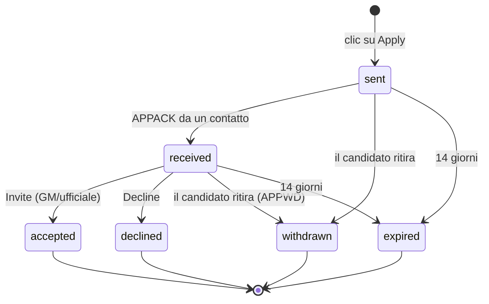

# SPEC-07: Candidature

## 1. Regole

| ID | Regola |
|---|---|
| APP-01 | Solo chi **non ha gilda** può candidarsi. |
| APP-02 | Al massimo **1 candidatura aperta** per personaggio (D16). Per candidarsi altrove bisogna prima ritirarla. |
| APP-03 | Il pulsante **Apply** è attivo solo se l'annuncio ha `apps = true` e i requisiti di livello e di equipaggiamento sono soddisfatti. Altrimenti è disattivato e il motivo compare sul pulsante e nel tooltip ("Requirements not met: level 40"). |
| APP-04 | Un clic invia la candidatura con i dati letti in automatico: nome, classe, razza, livello ed eventuale livello dell'equipaggiamento. Nessun modulo (D15). Nella conferma il giocatore può spuntare, se vuole, i **ruoli** che gioca (Tank, Healer, Melee DPS, Ranged DPS): solo quelli possibili per la sua classe, nessun testo libero. |
| APP-05 | La candidatura scade dopo **14 giorni** senza decisione. |
| APP-06 | Dopo un rifiuto non ci si può ricandidare alla **stessa** gilda per 7 giorni. |
| APP-07 | Solo il GM e gli ufficiali (`C_GuildInfo.IsGuildOfficer()`) vedono la casella delle candidature e l'icona di notifica (D14). |

## 2. Stati

- **sent**: salvata solo nel client del candidato, in attesa di un contatto online.
- **received**: almeno un ufficiale o il GM l'ha ricevuta (conferma con `APPACK`).
- **accepted**: un ufficiale ha premuto Invite. Si chiude da sola anche se il candidato entra nella gilda per altre vie: `PLAYER_GUILD_UPDATE` con il nome della gilda corrispondente.
- Gli stati finali restano 30 giorni nello storico, poi vengono eliminati.

## 3. Consegna (senza server)

Il candidato deve raggiungere un **contatto**, cioè il GM o un ufficiale online con l'addon.

1. Il client del candidato conosce i contatti dagli `ANN` con `c=1` ricevuti negli ultimi 30 minuti (nome del mittente e ora).
2. Clic su Apply: `APPLY` in `WHISPER` al contatto visto più di recente. Se in 15 s non arriva `APPACK`, prova il contatto successivo.
3. Se non c'è nessun contatto online la candidatura resta **sent**. L'interfaccia lo dice chiaramente: "Saved. It will be delivered when an officer of <Guild> comes online." Ogni volta che arriva un `ANN` con `c=1` per quella gilda, il client riprova: `APPLY` se è ancora sent, `APPPING` se è received, per sapere lo stato.
4. Il contatto risponde sempre con `APPACK{id, state}`. È così che il candidato scopre di essere stato accettato o rifiutato, anche giorni dopo.
5. Ritiro: `APPWD` al primo contatto disponibile. Fino alla conferma la candidatura resta "Withdrawing…" nel client del candidato, che però può già candidarsi altrove.

> Limite noto: la candidatura funziona solo mentre il candidato è online. Se il candidato e gli ufficiali non sono mai online nello stesso momento, la candidatura resta "sent". Come alternativa la pagina della gilda mostra sempre i contatti (Discord e personaggi).

## 4. Sincronizzazione tra ufficiali

- Ogni client di GM o ufficiale ha la propria casella (`officerInbox[guildKey]`, per personaggio).
- Alla ricezione di un `APPLY` o al cambio di stato: `APPSYNC` in `OFFICER` con il record aggiornato.
- All'entrata in gioco: `APPSYNC` con l'elenco compatto `{id: stateRev}`; chi ha record mancanti o più recenti li invia.
- Conflitti: vince lo `stateRev` più alto; a parità vince lo stato finale, nell'ordine accepted > declined > withdrawn > expired.
- Un ufficiale che perde il ruolo smette di ricevere e cancella la propria casella al login successivo.

## 5. Pannello "Applications" (GM e ufficiali)

Bozzetto: [`04-applications.webp`](mockups/img/04-applications.webp).

- Filtro in alto: **Pending (n)** / **History**.
- Una riga per candidatura: icona della classe, nome colorato per classe, livello, razza, livello dell'equipaggiamento (se c'è), "2 h ago", stato.
- Azioni sulla riga:
  - **Invite**: `C_GuildInfo.Invite(nome)`, cioè l'invito di Blizzard. Lo stato diventa accepted solo se l'invito parte senza errori. Se il candidato è offline, il gioco dà errore e il pannello dice "Player is offline, try later".
  - **Decline**: chiede conferma, poi lo stato diventa declined; il candidato lo saprà al prossimo contatto.
  - **Whisper**: apre la chat con `/w Nome `.
- Le righe accepted, declined, withdrawn ed expired vanno nello storico, con "by Ufficiale" e la data.
- Il numero di candidature in attesa compare sulla scheda ("Applications (3)").

## 6. Icona di notifica (D17)

Bozzetto: [`05-notification.webp`](mockups/img/05-notification.webp).

- Un pulsante rotondo di metallo di 56–64 px, con il bordo dorato e lo stemma della gilda (o un'icona generica) e un **badge rosso** con il numero di candidature in attesa.
- Visibile solo al GM e agli ufficiali, e solo se la gilda ha un annuncio.
- **Clic sinistro**: apre o chiude una lista rapida delle ultime 5 candidature in attesa, con Invite e Decline e il link "Open all applications" per aprire il pannello completo.
- **Trascinamento**: lo sposta; la posizione viene salvata per personaggio.
- **Clic destro**: un menu con Lock position, Hide icon, "Show only when there are pending applications".
- Si mostra e si nasconde anche con `/gf notify` e dalle impostazioni.
- Quando arriva una candidatura nuova: il badge si aggiorna, l'icona pulsa una volta, un messaggio in chat ("[Guild Finder] New application from Name (Mage 32)") e un suono facoltativo, attivo di base.

## 7. Lato candidato: "My Application"

- Una scheda per chi non ha gilda, con la candidatura aperta o lo stato vuoto ("You haven't applied to any guild").
- Mostra: stemma e nome della gilda, data, stato con spiegazione ("Waiting for an officer to come online", "Received by the guild", "Accepted: check your guild invite"), pulsanti **Withdraw** e **View guild**.
- Al cambio di stato: un messaggio in chat e un punto sulla scheda.

> **Nota di realizzazione (M4.1).** Il lato del candidato è in `Data/Applications.lua` (regole e transizioni in puro Lua), `UI/ApplyModel.lua` (testi), `UI/Apply.lua` (pulsante e conferma) e `UI/MyApplication.lua` (la scheda). Dettagli che il testo non dice:
>
> - **Dove si salva**: `AzerothGuildFinderCharDB.application = { recs = { ... } }`, per personaggio (APP-02 vale per personaggio, non per account), in ordine di invio. Ogni record ha i campi di SPEC-03 §8 più `upd` (ora dell'ultimo cambio di stato), `wd` (un ritiro ancora da consegnare: "Withdrawing...") e `unseen` (il punto sulla scheda). I record finali restano 30 giorni dall'ultimo cambio, al massimo 20 in tutto; quello aperto resta sempre. Al caricamento i record danneggiati vengono scartati e, se per un danno ce ne fossero due aperti, il più vecchio viene chiuso come `withdrawn`.
> - **Transizioni**: solo quelle del diagramma del §2; ogni cambio aumenta `stateRev` di uno e aggiorna `upd`; gli stati finali non si muovono più. Una decisione (`APPACK` con `accepted` o `declined`) che arriva quando il record è ancora `sent` passa prima da `received` (`stateRev` +2): l'ufficiale l'aveva, la conferma si era persa. La regola dei conflitti del §4 è già `Applications.Newer` per il M4.3.
> - **Scadenza** (APP-05): 14 giorni da `at`, controllata a ogni lettura, all'entrata nel mondo e ogni ora mentre una candidatura è aperta. **Rifiuto** (APP-06): 7 giorni da `upd` del rifiuto, solo per quella gilda; il ritiro e la scadenza non bloccano.
> - **Ritiro**: la candidatura passa subito a `withdrawn` con `wd = true` (il candidato può candidarsi altrove), la scheda dice "Withdrawing..." finché un `APPACK{state = "withdrawn"}` non toglie `wd`. Il pulsante Withdraw chiede conferma.
> - **Rete (M4.2)**: nel M4.1 non parte nessun messaggio. `Applications:Outbox()` dice cosa serve (`APPLY` per un record `sent`, `APPPING` per uno `received`, `APPWD` per un ritiro non confermato), il Bus annuncia `APPLICATION_OUTBOX(kind, id)` per ogni nuovo bisogno e `APPLICATION_CHANGED(id, state, oldState)` per ogni cambio; la risposta di un ufficiale entra con `Applications:OnAck(id, state)`.
> - **My Application**: mostra la candidatura aperta, altrimenti l'ultima chiusa finché resta nello storico (lo stato con la spiegazione, il percorso SENT > RECEIVED > ACCEPTED / DECLINED, i ruoli spuntati, "Expires in 12 days", "You can apply again on 15 Nov" dopo un rifiuto); **View guild** apre la pagina della gilda sopra la scheda (se l'annuncio c'è ancora). Un cambio che il giocatore non ha fatto (scadenza, risposta di un ufficiale) scrive una riga in chat e mette un badge "1" sulla scheda finché non la apre.
