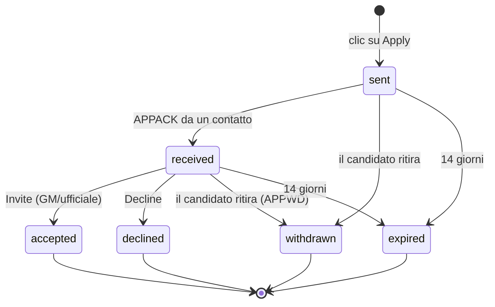

# SPEC-07: Candidature

## 1. Regole

| ID | Regola |
|---|---|
| APP-01 | Solo chi **non ha gilda** può candidarsi. |
| APP-02 | Al massimo **1 candidatura aperta** per personaggio (D16). Per candidarsi altrove bisogna prima ritirarla. |
| APP-03 | Il pulsante **Apply** è attivo solo se l'annuncio ha `apps = true` e i requisiti di livello e di equipaggiamento sono soddisfatti. Altrimenti è disattivato e il motivo compare sul pulsante e nel tooltip ("Requirements not met: level 40"). |
| APP-04 | Un clic invia la candidatura con i dati letti in automatico: nome, classe, razza, livello ed eventuale livello dell'equipaggiamento. Nessun modulo (D15). Nella conferma il giocatore può spuntare, se vuole, i **ruoli** che gioca (Tank, Healer, Melee DPS, Ranged DPS): solo quelli possibili per la sua classe, nessun testo libero. |
| APP-05 | La candidatura scade dopo **14 giorni** senza decisione. |
| APP-06 | Dopo un rifiuto non ci si può ricandidare alla **stessa** gilda per 7 giorni. |
| APP-07 | Solo il GM e gli ufficiali (`C_GuildInfo.IsGuildOfficer()`) vedono la casella delle candidature e l'icona di notifica (D14). |

## 2. Stati

- **sent**: salvata solo nel client del candidato, in attesa di un contatto online.
- **received**: almeno un ufficiale o il GM l'ha ricevuta (conferma con `APPACK`).
- **accepted**: un ufficiale ha premuto Invite. Si chiude da sola anche se il candidato entra nella gilda per altre vie: `PLAYER_GUILD_UPDATE` con il nome della gilda corrispondente.
- Gli stati finali restano 30 giorni nello storico, poi vengono eliminati.

## 3. Consegna (senza server)

Il candidato deve raggiungere un **contatto**, cioè il GM o un ufficiale online con l'addon.

1. Il client del candidato conosce i contatti dagli `ANN` con `c=1` ricevuti negli ultimi 30 minuti (nome del mittente e ora).
2. Clic su Apply: `APPLY` in `WHISPER` al contatto visto più di recente. Se in 15 s non arriva `APPACK`, prova il contatto successivo.
3. Se non c'è nessun contatto online la candidatura resta **sent**. L'interfaccia lo dice chiaramente: "Saved. It will be delivered when an officer of <Guild> comes online." Ogni volta che arriva un `ANN` con `c=1` per quella gilda, il client riprova: `APPLY` se è ancora sent, `APPPING` se è received, per sapere lo stato.
4. Il contatto risponde sempre con `APPACK{id, state}`. È così che il candidato scopre di essere stato accettato o rifiutato, anche giorni dopo.
5. Ritiro: `APPWD` al primo contatto disponibile. Fino alla conferma la candidatura resta "Withdrawing…" nel client del candidato, che però può già candidarsi altrove.

> Limite noto: la candidatura funziona solo mentre il candidato è online. Se il candidato e gli ufficiali non sono mai online nello stesso momento, la candidatura resta "sent". Come alternativa la pagina della gilda mostra sempre i contatti (Discord e personaggi).

> **Nota di realizzazione (M4.2).** La consegna è in `Net/Delivery.lua`; il deposito minimo dell'ufficiale in `Data/Inbox.lua` (il M4.3 aggiunge `APPSYNC`, lo storico e la pulizia: §4). Dettagli che il testo non dice:
>
> - **Contatti**: `Net/Sync.lua` ricorda in memoria il mittente di ogni `ANN` accettato con `c=1` (al massimo 10 per gilda) e annuncia sul Bus `CONTACT_SEEN(k, mittente)`. Contano quelli sentiti negli ultimi 30 minuti, il più recente per primo; mai sé stessi. Perché i candidati sentano davvero un contatto, il turno periodico di un GM o di un ufficiale salta solo per l'`ANN` di **un altro contatto**, non per quello di un membro (SPEC-02 §5).
> - **Tentativi**: ogni record di `Applications:Outbox()` è un lavoro con un solo messaggio in volo (`APPLY`, `APPPING` o `APPWD`, priorità `ALERT`). Parte quando nasce (Apply, Withdraw) e a ogni `CONTACT_SEEN` della sua gilda. Senza `APPACK` in 15 s si passa al contatto successivo; un contatto rimasto muto per quel record aspetta 60 s prima di essere riprovato, poi il doppio a ogni silenzio, al massimo 30 minuti. Una candidatura `received` chiede notizie (`APPPING`) al massimo ogni 20 minuti dopo l'ultima risposta (dopo un `/reload`, al primo contatto). Al massimo 6 sussurri al minuto da questo modulo.
> - **Risposte**: un `APPACK` è accettato solo da un contatto a cui il client ha sussurrato quell'id in questa sessione (anche oltre i 15 s); il resto è falso o vecchio e viene ignorato. Per un ritiro qualsiasi stato finale lo conferma: il record dell'ufficiale è chiuso comunque.
> - **Lato ufficiale**: `APPLY`, `APPPING` e `APPWD` contano solo in `WHISPER` e solo per il GM o un ufficiale della gilda della chiave (`Role`). Ogni campo dell'`APPLY` è controllato (INT-06): id di 8 esadecimali minuscoli, chiave valida, `who` senza spazi, controlli né `|` e **con il nome del mittente** (nessuno si candida per un altro), classe nota, razza 1–255, livello fino al massimo del client, ora non nel futuro (5 minuti di tolleranza) e non più vecchia di 14 giorni; `ilvl` e ruoli sbagliati vengono tolti, i ruoli tenuti solo se della classe; `state`, `stateRev` e `by` del messaggio non contano mai. Il record entra `received` con `stateRev` 2 (come nel client del candidato). Un id già noto risponde con lo stato che l'ufficiale ha (una decisione già presa torna così al candidato); una candidatura nuova dello stesso personaggio chiude come `withdrawn` quella aperta più vecchia (APP-02). `APPPING` risponde solo se l'id è noto e il mittente è il suo candidato; altrimenti silenzio (forse un altro ufficiale l'ha: lo saprà il M4.3). `APPWD` chiude il record; un id sconosciuto lascia una lapide `withdrawn` (`stateRev` 3, `tomb`) che una copia in ritardo e la sincronizzazione del M4.3 riconoscono. Risposte al massimo 6 al minuto per mittente e la stessa al massimo una volta ogni 5 s.
> - **Deposito**: `officerInbox[guildKey] = { recs = { [id] = record } }`, al massimo 200 record per gilda: quando è pieno esce il record chiuso più vecchio; se sono tutti aperti la candidatura nuova non entra e non riceve risposta (il candidato riproverà). Bus: `INBOX_CHANGED(k, id, state, oldState)`.
> - **Impossibile inviare** (SPEC-01 §8): se il gioco rifiuta un sussurro con un codice che riguarda il personaggio (`GeneralError`, `InvalidChatType`, `NotInGroup`, `TargetRequiresGuild`, `InvalidChannel` o un codice sconosciuto; `TargetOffline` o un eccesso di traffico riguardano solo quel messaggio e quel contatto, che conta subito come muto), se il canale è in solo ascolto o se i messaggi degli addon sono bloccati, `Delivery:CannotSend()` lo dice e My Application aggiunge sotto lo stato "Right now the game does not let this character send addon messages, so nothing can go out yet..." finché qualcosa resta da inviare. Il primo sussurro che parte toglie l'avviso.

## 4. Sincronizzazione tra ufficiali

- Ogni client di GM o ufficiale ha la propria casella (`officerInbox[guildKey]`, per personaggio).
- Alla ricezione di un `APPLY` o al cambio di stato: `APPSYNC` in `OFFICER` con il record aggiornato.
- All'entrata in gioco: `APPSYNC` con l'elenco compatto `{id: stateRev}`; chi ha record mancanti o più recenti li invia.
- Conflitti: vince lo `stateRev` più alto; a parità vince lo stato finale, nell'ordine accepted > declined > withdrawn > expired.
- Un ufficiale che perde il ruolo smette di ricevere e cancella la propria casella al login successivo.

> **Nota di realizzazione (M4.3).** La casella è in `Data/Inbox.lua`, la sincronizzazione in `Net/InboxSync.lua`. Dettagli che il testo non dice:
>
> - **Versione**: ogni record ha una versione, `Inbox.Version(rec)`, un intero a 32 bit che ordina due copie dello stesso id allo stesso modo su ogni client. Precisazione della regola dei conflitti: uno stato finale vince **sempre** su uno aperto (gli stati finali non si muovono più, §2); poi lo `stateRev` più alto; a parità lo stato finale nell'ordine accepted > declined > withdrawn > expired; poi un record completo su una lapide (`tomb`, un ritiro arrivato prima della candidatura); infine un hash di `upd` e `by`, così anche due decisioni prese nello stesso momento finiscono uguali ovunque. Sulle copie degli ufficiali la regola dà lo stesso risultato di `Applications.Newer` (M4.1) in tutti i casi reali (aperti 2, finali 3).
> - **Fusione**: vince la copia con la versione più alta; una lapide che incontra la copia completa prende i campi della candidatura (`who`, classe, razza, livello, `ilvl`, ruoli, `at`) e smette di essere una lapide. APP-02 vale anche per i record sincronizzati: di due candidature aperte dello stesso personaggio si chiude la più vecchia, con `upd` uguale all'`at` della più nuova. Lo stesso per la scadenza: un record aperto oltre i 14 giorni diventa `expired` con `upd` uguale al momento della scadenza, non a quello in cui il client se ne accorge. Così le modifiche che ogni ufficiale fa da solo producono record identici senza messaggi.
> - **Messaggi** (`APPSYNC`, `OFFICER`, priorità `NORMAL`):
>   - *cambio*: `{k, recs = {record, ...}}` 2 s dopo un `APPLY` ricevuto, un `APPWD` o una decisione (M4.4), insieme agli altri cambi di quel momento, 10 record per messaggio; la chiave della gilda viaggia una volta sola. Un record imparato da un altro ufficiale non viene rimandato.
>   - *elenco*: `{k, q = 1, ids = {[id] = versione}}` 5–15 s dopo l'entrata nel mondo (e quando il personaggio diventa ufficiale). Con 200 record sono circa 2,8 KB prima della compressione.
>   - *risposta*: chi sente un elenco risponde `{k, to = richiedente, ids}` con **solo** gli id in cui la propria copia è diversa, con la propria versione (0 = non ce l'ha); al massimo una risposta al minuto per mittente.
>   - *richiesta*: il richiedente raccoglie le risposte per 5 s, poi invia una volta sola (in `OFFICER`, la sentono tutti) i record che gli altri non hanno o hanno più vecchi, e chiede ogni record che gli manca **a un solo** ufficiale, quello con la copia più nuova (a parità un hash dell'id e del nome divide il lavoro): `{k, to = ufficiale, want = {id, ...}}`. L'ufficiale invia i record chiesti (al massimo una richiesta ogni 10 s per mittente).
>   - *copia vecchia*: chi riceve un record più vecchio del proprio rimanda il proprio dopo 1–4 s, a meno che nel frattempo un altro ufficiale abbia inviato una copia almeno altrettanto nuova.
> - **Limiti**: al massimo 10 messaggi al minuto dal modulo e un messaggio di record ogni 1,5 s (il resto aspetta); un messaggio con più di 400 id o 50 record non viene letto oltre. Nel simulatore 60 record arrivano a un ufficiale che entra in gioco in circa 25 s, ognuno inviato una volta sola.
> - **Controlli** (INT-06): un `APPSYNC` conta solo da `OFFICER` (o da `GUILD` con il ripiego sotto), da un nome valido che non sia il proprio (l'eco), e solo se chi lo riceve è il GM o un ufficiale della gilda della chiave. Ogni record è controllato campo per campo (`Inbox.Sanitize`): id di 8 esadecimali minuscoli, stato valido ma mai `sent`, `stateRev` 2–15, `at` e `upd` interi non nel futuro (5 minuti di tolleranza), `who` e `by` nomi senza spazi, controlli né `|`, classe nota, razza 1–255, livello 1–255 (non richiesti per una lapide, che può essere solo `withdrawn`); `ilvl`, ruoli fuori classe e un `by` sbagliato vengono tolti; un record chiuso con lo storico già finito non viene ripreso. I record sbagliati sono scartati uno per uno, gli altri del messaggio contano.
> - **Storico e limite**: un record chiuso viene cancellato 30 giorni dopo l'ultimo cambio (controllo a ogni elenco e ogni ora); al massimo 200 record per gilda: quando è piena esce il record chiuso più vecchio, e un record chiuso più vecchio di tutti quelli tenuti non viene ripreso (verrebbe cancellato di nuovo); se sono tutti aperti non entra niente e la casella non chiede altri record.
> - **Ruolo perso**: un personaggio che non è più GM o ufficiale ignora subito ogni `APPSYNC` e non ne invia; 60 s dopo l'entrata nel mondo successiva (quando gilda e grado sono sicuramente noti) cancella la propria casella e quella di ogni altra gilda (`INBOX_CLEARED`). Al caricamento i record salvati danneggiati vengono scartati.
> - **Ripiego** (spike S5): se `OFFICER` non accettasse i messaggi degli addon, `InboxSync.DIST` diventa `"GUILD"` (SPEC-02 §7). I membri li ricevono e li ignorano (non sono contatti); un messaggio in `GUILD` conta solo se il roster dice che il grado del mittente legge la chat degli ufficiali (`C_GuildInfo.GuildControlGetRankFlags`, terzo permesso [verificare]); quelli in `OFFICER` contano sempre.
> - **Bus**: `INBOX_CHANGED(k, id, state, oldState, source)` con `source` nil per un cambio locale (va agli altri ufficiali), `"sync"`, `"rule"` (APP-02), `"sweep"` (scadenza e storico; `state` nil per un record cancellato) o `"limit"`; `INBOX_CLEARED(k)`; `INBOX_SYNC(what)`. `Inbox:Decide(k, id, state, by)` è l'aggancio di Invite e Decline per il M4.4. `/gf debug` ha la sezione InboxSync (nessun nome).

## 5. Pannello "Applications" (GM e ufficiali)

Bozzetto: [`04-applications.webp`](mockups/img/04-applications.webp).

- Filtro in alto: **Pending (n)** / **History**.
- Una riga per candidatura: icona della classe, nome colorato per classe, livello, razza, livello dell'equipaggiamento (se c'è), "2 h ago", stato.
- Azioni sulla riga:
  - **Invite**: `C_GuildInfo.Invite(nome)`, cioè l'invito di Blizzard. Lo stato diventa accepted solo se l'invito parte senza errori. Se il candidato è offline, il gioco dà errore e il pannello dice "Player is offline, try later".
  - **Decline**: chiede conferma, poi lo stato diventa declined; il candidato lo saprà al prossimo contatto.
  - **Whisper**: apre la chat con `/w Nome `.
- Le righe accepted, declined, withdrawn ed expired vanno nello storico, con "by Ufficiale" e la data.
- Il numero di candidature in attesa compare sulla scheda ("Applications (3)").

> **Nota di realizzazione (M4.4).** Il pannello è in `UI/Applications.lua`, il modello di vista (puro Lua) in `UI/ApplicationsModel.lua`, Invite e Decline in `Data/Decisions.lua`. Dettagli che il testo non dice:
>
> - **Chi lo vede**: la scheda *Applications* esiste solo per il GM e gli ufficiali di una gilda con annuncio (`Nav.TabsFor`); il pannello ricontrolla il ruolo a ogni disegno e `Decisions` a ogni azione (`role`): un membro che aprisse la pagina non vedrebbe righe né contatori e non potrebbe decidere. Il numero sulla scheda e nel tooltip del pulsante della minimappa (`Main.pendingProvider`) è il numero delle candidature in attesa.
> - **Righe**: *Pending* è l'elenco delle candidature aperte, la più recente prima; *History* le chiuse (e le aperte oltre i 14 giorni, mostrate come `expired` anche prima che la pulizia le scriva), l'ultimo cambio prima. Una scheda mostra icona della classe con l'anello, nome nel colore della classe (scurito per la pergamena), ruoli, livello, razza, livello dell'equipaggiamento (`iLvl —` se manca), "2 h ago" e uno stato: **RECEIVED** per le candidature di meno di due giorni, poi **EXPIRES IN n DAYS** (ambra a 3 giorni o meno) e **INVITING...** mentre un invito è in osservazione; **NEW** (bordo dorato) per quelle arrivate dopo l'ultima uscita dalla scheda (`char.ui.appsSeenAt`). Lo storico mostra "by Ufficiale · data" (`by the player` per un ritiro, `after 14 days` per una scadenza). Un ritiro arrivato prima della candidatura (lapide) ha il nome e "Details unknown". La razza è il nome del client (`C_CreatureInfo.GetRaceInfo`), con le otto razze del gioco originale come ripiego. Contatori a sinistra: *Pending* e *Accepted · 30 days* (lo storico dura 30 giorni).
> - **Decline**: chiede conferma e chiama `Inbox:Decide(k, id, "declined", ufficiale)`. Nessun messaggio parte da qui: `INBOX_CHANGED` fa partire `APPSYNC` verso gli altri ufficiali (entro 2 s) e il candidato lo sa al contatto successivo, perché `APPPING` e `APPLY` ripetuti ricevono lo stato dell'ufficiale (§3.4); se il candidato è online, accade al prossimo `ANN` di un contatto.
> - **Invite**: `C_GuildInfo.Invite(nome)` non restituisce nulla e un rifiuto arriva come messaggio, quindi lo stato diventa `accepted` solo quando l'invito è partito senza errori: il messaggio del gioco "You have invited ..." lo accetta subito, un messaggio di errore nei successivi 3 secondi lo rifiuta ("X is offline. Try again later." per un giocatore non in linea, il testo del gioco per gli altri: già in una gilda, nessun permesso...), e 3 secondi senza errori lo contano come inviato. Durante l'attesa la scheda dice INVITING... e Invite e Decline sono spenti. Se nel frattempo un altro ufficiale ha deciso, la decisione resta quella e il pannello lo dice. I testi del gioco si leggono dalle stringhe globali del client (`ERR_GUILD_INVITE_S`, `ERR_CHAT_PLAYER_NOT_FOUND_S`, ...) con il testo inglese come ripiego **[da verificare in gioco]**.
> - **Ripiego dell'invito** (spike S10, M0.6, non ancora eseguito): se `C_GuildInfo.Invite` manca, il client la rifiuta con un errore o la segnala come azione protetta (`ADDON_ACTION_FORBIDDEN` o `ADDON_ACTION_BLOCKED` per l'addon), il pulsante apre la chat con `/ginvite Nome ` già scritto e la riga offre **Mark as invited**; il messaggio "You have invited ..." nei 90 secondi dopo l'apertura segna l'invito da solo. Per il resto della sessione si va direttamente al ripiego. Se nemmeno la chat si può aprire, il pannello dice di invitare a mano (clic destro sul nome, *Invite to guild*) e di segnare l'invito dopo; **Whisper** resta disponibile.
> - **Opzioni di notifica**: tre interruttori (*Notification icon on screen*, *Only when something is pending*, *Sound on new application*) a sinistra del pannello e nella scheda *Settings* (solo per GM e ufficiali), salvati in `account.settings` (`notifyIcon`, `onlyWhenPending`, `sound`); un cambio annuncia `NOTIFY_OPTIONS_CHANGED(chiave, valore)` sul Bus. L'icona è del M4.5, che legge le stesse tre chiavi.
> - **Bus**: `DECISION_STARTED(k, id)` quando un invito è in osservazione; `DECISION_RESULT(k, id, esito, dettaglio)` con esito `accepted`, `declined`, `offline`, `refused`, `manual` o `changed`. `/gf debug` ha le sezioni Decisions e Applications panel (nessun nome).

## 6. Icona di notifica (D17)

Bozzetto: [`05-notification.webp`](mockups/img/05-notification.webp).

- Un pulsante rotondo di metallo di 56–64 px, con il bordo dorato e lo stemma della gilda (o un'icona generica) e un **badge rosso** con il numero di candidature in attesa.
- Visibile solo al GM e agli ufficiali, e solo se la gilda ha un annuncio.
- **Clic sinistro**: apre o chiude una lista rapida delle ultime 5 candidature in attesa, con Invite e Decline e il link "Open all applications" per aprire il pannello completo.
- **Trascinamento**: lo sposta; la posizione viene salvata per personaggio.
- **Clic destro**: un menu con Lock position, Hide icon, "Show only when there are pending applications".
- Si mostra e si nasconde anche con `/gf notify` e dalle impostazioni.
- Quando arriva una candidatura nuova: il badge si aggiorna, l'icona pulsa una volta, un messaggio in chat ("[Guild Finder] New application from Name (Mage 32)") e un suono facoltativo, attivo di base.

> **Nota di realizzazione (M4.5).** L'icona è in `UI/Notify.lua`, le regole (puro Lua) in `UI/NotifyModel.lua`. Dettagli che il testo non dice:
>
> - **Chi la vede**: GM e ufficiali di una gilda con annuncio, poi `notifyIcon` e `onlyWhenPending` (account). Il pulsante appare e sparisce da solo con `ROLE_CHANGED`, `CATALOG_UPDATED`, `INBOX_CHANGED` e `NOTIFY_OPTIONS_CHANGED`; finché è visibile il conteggio viene riletto ogni minuto (una candidatura può scadere).
> - **Candidatura nuova**: parla (riga in chat, suono se `sound`) solo un record aperto che arriva direttamente dal candidato (`INBOX_CHANGED` senza `source`); una copia da `APPSYNC` (`source` `"sync"`) muove solo il badge, per non inondare un ufficiale che rientra. La riga e il suono arrivano anche con l'icona nascosta. Il badge che sale fa pulsare l'alone una volta (1,4 s).
> - **Link**: `|Haddon:AzerothGuildFinder:applications|h[Open]|h`, agganciato con `hooksecurefunc("SetItemRef")`; apre la scheda Applications. Non provato nel gioco.
> - **Lista rapida**: le ultime 5 in attesa (la più nuova per prima), "and n more", Invite e Decline (con domanda) come nel pannello; gli esiti dell'invito vanno in chat se la finestra non è aperta.
> - **Posizione e blocco**: `char.ui.notifyPos` (punto, punto relativo, x, y) e `char.ui.notifyLocked` per personaggio; una posizione fuori schermo viene riportata dentro. Il menu del clic destro ha Lock position, Show only when something is pending, Sound, Hide icon; `/gf notify` accende e spegne `notifyIcon` e avvisa chi non può averla.

## 7. Lato candidato: "My Application"

- Una scheda per chi non ha gilda, con la candidatura aperta o lo stato vuoto ("You haven't applied to any guild").
- Mostra: stemma e nome della gilda, data, stato con spiegazione ("Waiting for an officer to come online", "Received by the guild", "Accepted: check your guild invite"), pulsanti **Withdraw** e **View guild**.
- Al cambio di stato: un messaggio in chat e un punto sulla scheda.

> **Nota di realizzazione (M4.1).** Il lato del candidato è in `Data/Applications.lua` (regole e transizioni in puro Lua), `UI/ApplyModel.lua` (testi), `UI/Apply.lua` (pulsante e conferma) e `UI/MyApplication.lua` (la scheda). Dettagli che il testo non dice:
>
> - **Dove si salva**: `AzerothGuildFinderCharDB.application = { recs = { ... } }`, per personaggio (APP-02 vale per personaggio, non per account), in ordine di invio. Ogni record ha i campi di SPEC-03 §8 più `upd` (ora dell'ultimo cambio di stato), `wd` (un ritiro ancora da consegnare: "Withdrawing...") e `unseen` (il punto sulla scheda). I record finali restano 30 giorni dall'ultimo cambio, al massimo 20 in tutto; quello aperto resta sempre. Al caricamento i record danneggiati vengono scartati e, se per un danno ce ne fossero due aperti, il più vecchio viene chiuso come `withdrawn`.
> - **Transizioni**: solo quelle del diagramma del §2; ogni cambio aumenta `stateRev` di uno e aggiorna `upd`; gli stati finali non si muovono più. Una decisione (`APPACK` con `accepted` o `declined`) che arriva quando il record è ancora `sent` passa prima da `received` (`stateRev` +2): l'ufficiale l'aveva, la conferma si era persa. La regola dei conflitti del §4 è già `Applications.Newer` per il M4.3.
> - **Scadenza** (APP-05): 14 giorni da `at`, controllata a ogni lettura, all'entrata nel mondo e ogni ora mentre una candidatura è aperta. **Rifiuto** (APP-06): 7 giorni da `upd` del rifiuto, solo per quella gilda; il ritiro e la scadenza non bloccano.
> - **Ritiro**: la candidatura passa subito a `withdrawn` con `wd = true` (il candidato può candidarsi altrove), la scheda dice "Withdrawing..." finché un `APPACK{state = "withdrawn"}` non toglie `wd`. Il pulsante Withdraw chiede conferma.
> - **Rete (M4.2)**: nel M4.1 non parte nessun messaggio. `Applications:Outbox()` dice cosa serve (`APPLY` per un record `sent`, `APPPING` per uno `received`, `APPWD` per un ritiro non confermato), il Bus annuncia `APPLICATION_OUTBOX(kind, id)` per ogni nuovo bisogno e `APPLICATION_CHANGED(id, state, oldState)` per ogni cambio; la risposta di un ufficiale entra con `Applications:OnAck(id, state)`.
> - **My Application**: mostra la candidatura aperta, altrimenti l'ultima chiusa finché resta nello storico (lo stato con la spiegazione, il percorso SENT > RECEIVED > ACCEPTED / DECLINED, i ruoli spuntati, "Expires in 12 days", "You can apply again on 15 Nov" dopo un rifiuto); **View guild** apre la pagina della gilda sopra la scheda (se l'annuncio c'è ancora). Un cambio che il giocatore non ha fatto (scadenza, risposta di un ufficiale) scrive una riga in chat e mette un badge "1" sulla scheda finché non la apre.
