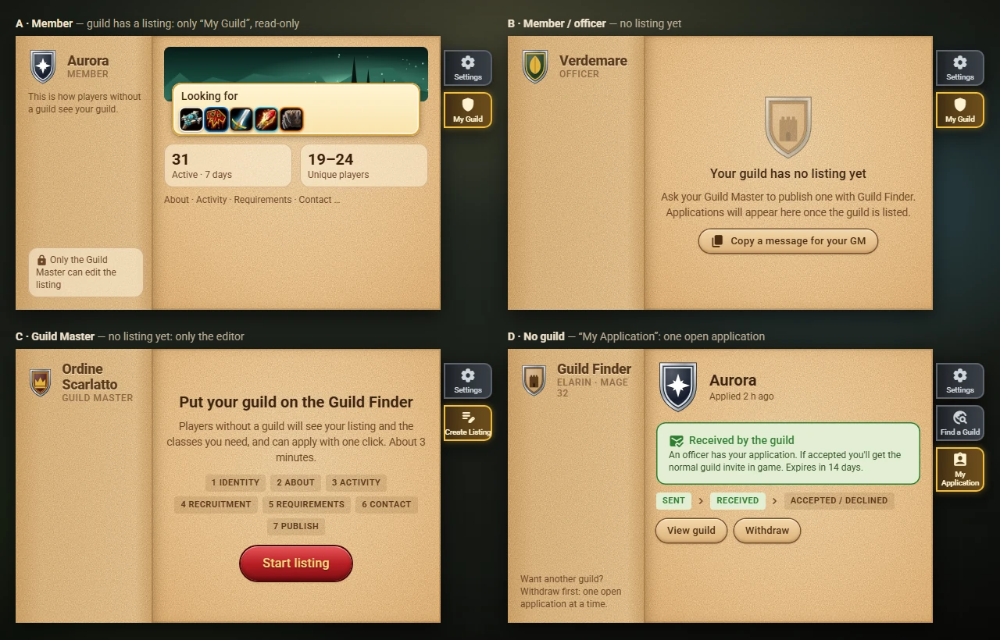

# Applying

> **Status:** applying works in the addon since M4.1, but the application is only **saved on your character** for now: delivering it to the guild's officers arrives with M4.2. Nothing of this has been tried in WoW Forever yet.

## Apply in three steps

1. In **Find a Guild**, press **Apply** on a guild's card, or open the guild page and press **Apply to *Guild***.
2. A short question asks *Apply to Aurora with Elarin (Mage 32)?*. Tick the **roles you play** if you want (Tank, Healer, Melee DPS, Ranged DPS): only the roles your class can play are offered, and ticking none is fine. Press **Apply**.
3. Your character's name, class, race, level and item level are read from the game and saved as your application. There is no form and no message to write. A note says *Saved. It will be delivered when an officer of Aurora comes online.*

Only the Guild Master and the officers of that guild will see your application.

## The Apply button

The button tells you, in its text and in its tooltip, whether you can apply and why not:

| The button says | Why | What to do |
|---|---|---|
| **Apply** (red) | you can apply | press it |
| **Applied · Waiting for an officer** | you applied here; no officer has it yet | click it to see your application |
| **Applied · Received** | an officer of the guild has your application | click it to see your application |
| **You already applied to *Guild*** | you have an open application elsewhere | withdraw it first (one at a time) |
| **Requirements not met** | your level or item level is below the guild's minimum; the tooltip says which | level up, or contact the guild |
| **You can apply again on 15 Nov** | this guild declined you less than 7 days ago | wait until that day |
| **Your character can't send addon messages yet** | the game does not let this character send addon messages (often a new or low-level character) | use the guild's contacts meanwhile |
| **You are already in a guild** | only characters without a guild can apply | — |
| no button, *Applications via addon are closed. Use the contacts below.* | the Guild Master closed applications through the addon | use Discord or whisper a contact |

On the guild page a line under the button explains the same thing.

## My Application

The **My Application** tab shows your application: the guild, when you applied, its status with an explanation, the road *SENT > RECEIVED > ACCEPTED / DECLINED*, the roles you ticked and how many days are left before it expires.

| Status | Meaning |
|---|---|
| *Waiting for an officer to come online* | saved on your character; it goes out when an officer of the guild is online with Guild Finder |
| *Received by the guild* | an officer has it |
| *Accepted: check your guild invite* | you get the normal guild invite in game |
| *Declined* | you can apply to other guilds now, and to this one again after 7 days |
| *Withdrawing...* / *Withdrawn* | you withdrew it; *Withdrawing...* until an officer learns it |
| *Expired* | 14 days passed without a decision |

- **View guild** opens the guild page; **Back** returns to the tab.
- **Withdraw** asks first. After it you can apply to another guild at once (or to the same one again).
- When something changes that you did not do (an officer's answer, the expiry) a line appears in the chat and a dot on the tab until you open it.
- Without an application the tab says *You haven't applied to any guild* and has a button to Find a Guild.

## Rules

- **One open application per character.** Your other characters can each have their own. To apply elsewhere, withdraw the current one first.
- An application **expires after 14 days** without a decision.
- After a **decline** you can apply to the same guild again after **7 days**; other guilds at once.
- Only a character **without a guild** can apply, and only to a guild that accepts applications through the addon.
- Your application stays on your computer (in your character's saved data) and, from M4.2, goes only to the Guild Master and the officers of that guild. Closed applications are forgotten after 30 days.
