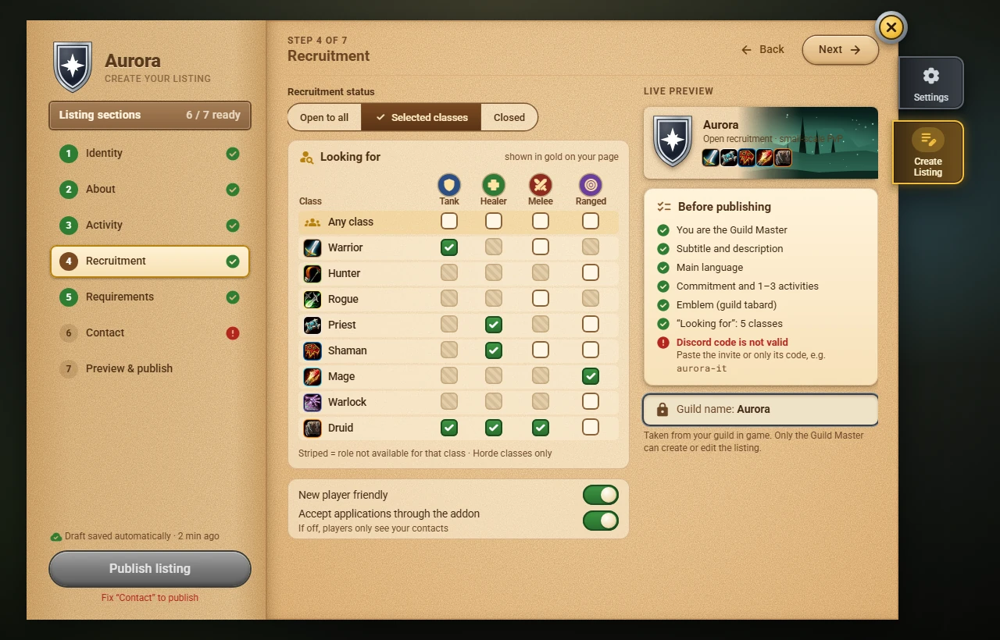
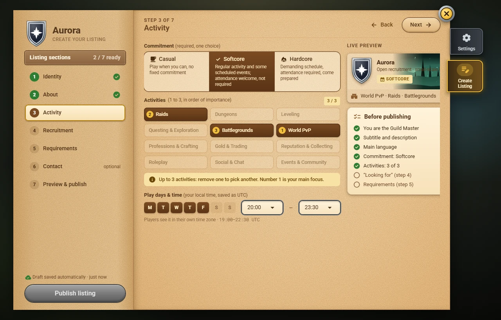

# Creating a listing

Only the **Guild Master** can create or edit the guild's listing. Open `/gf`: a Guild Master whose guild has no listing sees **Create Listing**. Everybody else never gets this page. If you reach it anyway, a note covers it and nothing can be saved.

## The seven steps

The **left page** lists the seven steps. Each shows its state: a green check when it is ready, a red cross when something in it is wrong, *optional* when there is nothing you have to fill in. *n / 7 ready* counts them. Click a step to jump to it, or use **Back** and **Next** in the title bar.

1. **Identity**: the guild name (taken from the game, you cannot change it here), subtitle, [[emblem|Emblems]] and banner.
2. **About**: description and languages.
3. **Activity**: commitment (**Casual**, **Softcore** or **Hardcore**), up to 3 activities in order of importance, play days and hours.
4. **Recruitment**: status, the *Looking for* grid of classes and roles, new player friendly, applications through the addon.
5. **Requirements**: minimum level, optional item level, a note.
6. **Contact**: the Discord invite code and up to three contact characters.
7. **Preview & publish**: the card as other players will see it, and the checklist.

> **Not checked in the game yet.** Every step is there, but none has been tried in WoW Forever yet. Nothing is lost if something is wrong: the draft stays on your computer until you publish.

## Step 1: Identity

- **Guild name**: read from your guild in game and locked. To change it, rename the guild in the game.
- **Subtitle** (required): one line, up to **60 characters**. The counter next to it (*0 / 60*) shows how many you used; what you type past 60 is cut off, and line breaks are not allowed. It is shown under the guild name in the list.
- **Banner** (optional): the picture behind your guild's card and page. Pick one of the thumbnails, or **Default** for the plain parchment. If no thumbnail is offered, the pictures have not been confirmed for your version of the game yet, and the page says so.
- **Emblem** (required): **Guild tabard** copies your guild tabard (chosen for you when the guild has one; *Update emblem* appears when the tabard changed in the game) and **Custom emblem** opens the emblem designer: background, border style and colour, emblem and its colour, Random and Reset. The emblem you design is used only in Guild Finder. See [[Emblems|Emblems]].

## Step 2: About

- **Description** (required, at least **30 characters**): up to **500 characters** and **12 lines**. Two counters (*0 / 500* and *0 / 12 lines*) show what is left; past either limit, what you type is cut off. Pipes (`|`) count double because the game would otherwise read them as colour codes.
- **Main language** (required): the language your guild speaks. It is the first one shown on the card.
- **Also spoken** (optional): any other languages. The menu waits until you pick a main language and never lists it again. If you change the main language, the other ones stay, and a language that becomes the main one leaves this list.

## Step 3: Activity

- **Commitment** (required, one choice): **Casual** (play when you can, no fixed commitment), **Softcore** (regular activity and some scheduled events; attendance is welcome, not required) or **Hardcore** (demanding schedule, attendance required, preparation expected). It is the guild's commitment, not permadeath. The line under the buttons explains the one you picked.
- **Activities** (required, **1 to 3**): click the activities your guild does. The order you click is the order of importance, shown as **1**, **2**, **3** on the chips; number 1 is the main focus. After three, the other chips are greyed out (hover one for the reason): remove one to pick another. Removing one renumbers the rest.
- **Play days & time** (optional): tick the days and pick a start and an end, every 30 minutes, in **your own local time**. The addon saves them in UTC and the line under the menus shows the UTC window; players see it converted to *their* time zone. A window can run past midnight (for example 22:00–01:00). **All day** means no fixed hours. If your country changes its clocks, the UTC window you saved stays the same until you edit it, so open this step again after the change if you want the same local hours.

## Step 4: Recruitment

- **Recruitment status**: **Open to all**, **Selected classes** or **Closed**. *Open to all* asks for every class and every role (you can still untick some). *Closed* clears the grid below and greys it out: a closed guild looks for nobody. If you go back to *Selected classes*, the grid you had comes back.
- **Looking for**: a grid with one row per class and a column per role: **Tank**, **Healer**, **Melee DPS** and **Ranged DPS**. Only the classes **your faction can play** are listed (no Paladin for the Horde, no Shaman for the Alliance). A role a class cannot play is dimmed (hover it for the reason) and cannot be ticked. Click a cell to tick or clear it; click the **class name** to tick or clear every role it can play. The **Any class** row means "whatever the class": use it when you only care about the role. The count at the top right says how many classes you chose. Choosing something in the grid also sets the status to *Selected classes* if you had not picked one. The listing needs at least one class and role, or the status *Closed*.
- **New player friendly**: shows a tag on your listing so that players who are new to the game know they are welcome.
- **Accept applications through the addon**: on at first. If you turn it off, players only see your contacts.

## Step 5: Requirements

- **Minimum level**: drag the slider from level 1 to the highest level of the game. **Level 1 means no minimum**, and the listing then shows no level requirement.
- **Minimum item level** (optional): switch it on and type the average item level (digits only, 1 to 999). Switching it off removes the requirement. Players who are below it see that they do not meet it.
- **Note** (optional): up to **120 characters**, for example *Voice chat required for raids*. The counter shows how many you used.

## Step 6: Contact

- **Discord** (optional): the invite address starts with the fixed text `https://discord.gg/`; you only write the **code** after it, for example `aurora-it` (letters, digits and hyphens, 2 to 32 characters). You can also **paste a whole invite link** (`https://discord.gg/aurora-it`, `discord.gg/aurora-it` or `https://discord.com/invite/aurora-it`): the addon keeps only the code and shows it in the box. If what you typed cannot be an invite, a red line under the box says why (another website, too short, too long, or a character that is not allowed), and the *Discord code valid* item of the checklist and the step turn red until you fix it or clear the box.
- **Characters to contact** (optional): up to **3** characters **of your guild** that players can whisper. With the box empty the list offers the members who are online, in the colour of their class; type the first letters of a name (capitals and accents do not matter) to narrow it down, then click a member or press Enter. Only members of your guild can be chosen. The **x** on a row removes it. If a chosen character leaves the guild, its row says so in red; it stays until you remove it. While the guild list is still loading the card says so and nobody is marked as gone.

## The live preview and the checklist

On the right of every step you see the **live preview**: the card other players will see in Find a Guild, updated as you type, with your guild's statistics as the announcements will carry them (*31 active / 149*, counted from the guild roster). Under it, the **Before publishing** checklist:

- You are the Guild Master
- Subtitle
- Description: at least 30 characters
- Main language
- Commitment (Casual, Softcore or Hardcore)
- 1 to 3 activities
- Emblem (tabard or designed)
- "Looking for" set, or recruitment closed
- Discord code valid (only if filled in)

A green check means done, an empty circle means nothing there yet, a red cross means something is wrong (the line under it says what). **Click an item to go to the step that fixes it.**

## The draft

Everything you type is saved as a **draft** at once, on your computer only. Close the window, log out, `/reload`: it is still there when you come back. Nothing is sent to anybody until you publish. **Discard changes** throws the draft away (after asking) and brings back the last published version, or an empty editor if there is none.

## Publish

**Publish listing** is the red button at the bottom of the left page. It stays grey, with the reason written under it, until:

- every required item of the checklist is green (the button tells you which step to fix: *Fix "Contact" to publish*; pressing it takes you there);
- you are still the Guild Master (the addon asks the game again before saving);
- five minutes have passed since your last published change (the time left counts down on the button's reason).

Once your listing is out, the same button says **Save changes** and is grey, with *Nothing has changed since the last published version*, until you change something. **Delist** (shown while the listing is out) removes your guild from Guild Finder after asking: pending applications will be closed, and the editor comes back filled with your last listing so you can publish it again with one click.

See [[Publishing a Listing|Publishing-a-Listing]] for what happens after you publish, the five-minute limit and a change of Guild Master.
