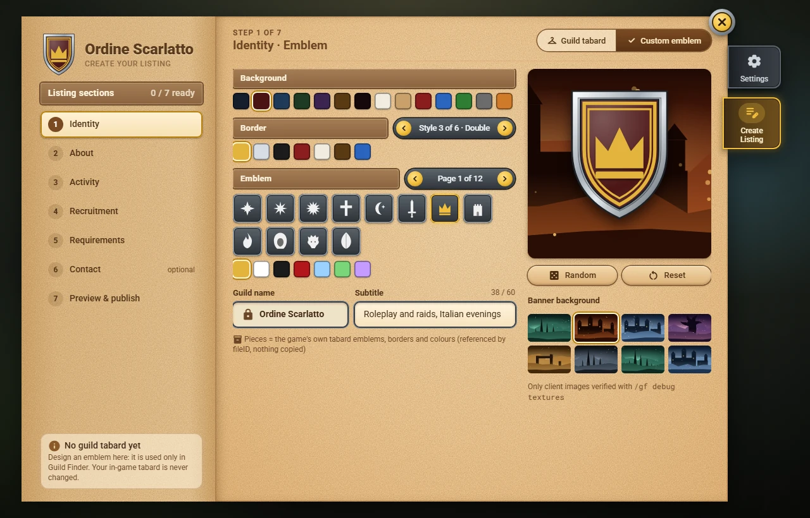

# Emblems

Every listing has an **emblem**: a shield with a background colour, a border, an emblem and a steel frame. It is shown on your guild's card in Find a Guild, on your guild page (150 px, also what your own guild's members see in **My Guild**, see [[Publishing a Listing|Publishing-a-Listing]]) and in the listing editor. You set it in step 1 of the editor, **Identity** (see [[Creating a Listing|Creating-a-Listing]]).

## Guild tabard or custom emblem

The **Emblem** card of the Identity step has two buttons:

- **Guild tabard**: the listing uses your guild's tabard as it is: emblem, border and colours. It is chosen for you when your guild has a tabard.
  - Right after you log in, the game may not have sent the tabard yet: the card says *Reading your guild tabard...* and fills in by itself.
  - If you change the tabard in the game later, the card says *Your tabard changed: update the emblem?*. Nothing changes on its own: click **Update emblem** to take the new one.
- **Custom emblem**: opens the **emblem designer**. Use it when your guild has no tabard, or if you prefer another emblem for Guild Finder.

A custom emblem is used **only in Guild Finder**. Your tabard in the game is never changed and no gold is spent.

## The emblem designer

The designer covers the step page. Every click is saved at once in your draft, and the big preview at the bottom shows the result.

- **Background**: click a colour.
- **Border**: the arrows change the style (*Style 3 of 6 - Double*); the colours below it colour the border.
- **Emblem**: a grid of 16 emblems per page; the arrows turn the pages. The game's tabard emblems come first, then a few symbols of Guild Finder's own. The colours below the grid colour the emblem; the chosen emblem shows in its colour, the others in white.
- **Random** draws a whole design. The emblem and the border always stand out from the background.
- **Reset** goes back to your published design. If you have none, it starts from your guild tabard's pieces, or from a plain design.
- **Done** closes the designer. **Design emblem** on the Emblem card opens it again on the same design. **Guild tabard** takes your tabard back; a second click on **Custom emblem** brings back your last design.

## What other players see

- Everybody's game draws the same emblem from the same pieces, so your emblem looks the same to every player.
- The emblem pieces are the game's own tabard pieces, drawn by each player's game: Guild Finder does not copy any picture of the game.
- If a player's game cannot draw a piece (for example an older version of Guild Finder that does not know it yet), that player sees your guild's **initial** in place of the emblem, or no border. A listing without an emblem shows a plain blue shield with the initial in gold. The same shield, faded, stands in the empty **My Guild** page of a guild that has no listing yet.

> **Not checked in the game yet.** The list of tabard pieces in this version is provisional: it is confirmed with the in-game checks of the first version. Until then some emblems may show as **?** in the designer, or the designer may offer only Guild Finder's own symbols if your game does not have the tabard emblems at all. Your choice is kept either way.
