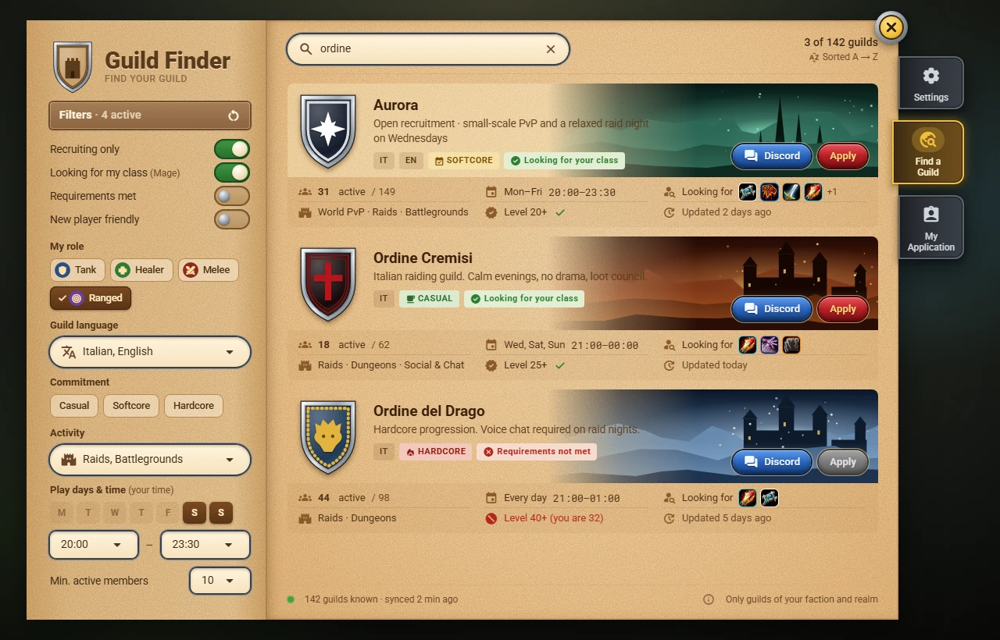

# Finding a guild

Open Guild Finder with `/gf` and choose **Find a Guild**.

## Search and filters

- **Search**: type at least 3 letters of the guild name. Accents, spaces, digits and symbols are ignored, so `ordine` also finds *Ördine del Drago*.
- **Recruiting only**, **Looking for my class**, **Requirements met**, **New player friendly**: switches.
- **My role**: Tank, Healer, Melee, Ranged.
- **Guild language**, **Commitment** (Casual, Softcore, Hardcore), **Activity**.
- **Play days and time**: in your time zone.
- **Min. active members**: active in the last 7 days.

The plate at the top shows how many filters are active; the round arrow resets them.

## The list

Guilds are **always in alphabetical order**: nobody can pay or post repeatedly to be first. Each card shows the emblem, name, subtitle, languages, commitment, a check if they need your class, and a band with active members, schedule, wanted classes, activities and the main requirement. **Discord** opens the invite link ready to copy; **Apply** applies; a click elsewhere opens [[The Guild Page|The-Guild-Page]].

Only guilds of **your faction and realm** are shown.
