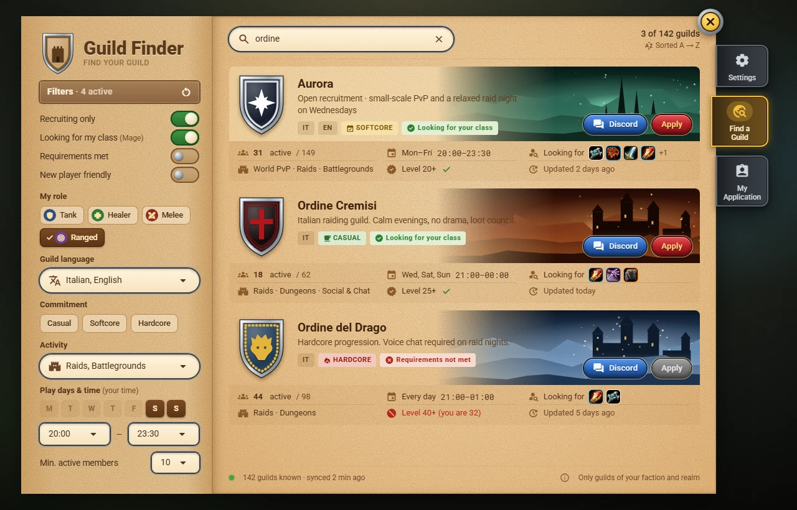

# Azeroth Guild Finder

**Find your guild without leaving the game.** Azeroth Guild Finder is an addon for **World of Warcraft: Forever** that lets players without a guild browse guild listings and apply with one click, while Guild Masters publish a listing and officers manage the applications.

> **Status: design phase.** This manual describes the planned first version. There is no download yet; screens are design mockups, not in-game screenshots.

## Start here

| I am… | Read |
|---|---|
| Looking for a guild | [[Finding a Guild|Finding-a-Guild]] → [[The Guild Page|The-Guild-Page]] → [[Applying|Applying]] |
| A Guild Master | [[Publishing a Listing|Publishing-a-Listing]] → [[Emblems|Emblems]] → [[Managing Applications|Managing-Applications]] |
| An officer | [[Managing Applications|Managing-Applications]] |
| New to the addon | [[Installation|Installation]] and the [[Interface Tour|Interface-Tour]] |

## What you see depends on your role

| You are | You see |
|---|---|
| Without a guild | **Find a Guild** and **My Application** |
| A guild member | **My Guild** (your guild's listing, read-only) |
| An officer | **My Guild** and **Applications** |
| The Guild Master | **Create Listing**, then **My Guild** and **Applications** once published |

**Settings** is always the first entry of the side rail.
