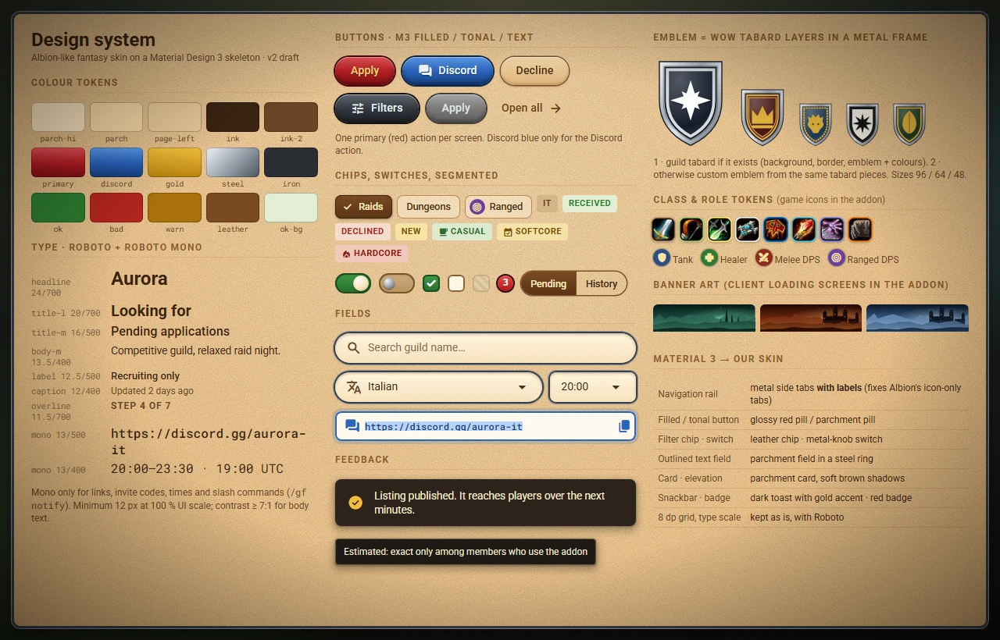

# Interface tour

The window is an open book: the **left page** holds the context (filters, the guild's actions, the editor's steps), the **right page** holds the content: a title bar, the page itself and a status line at the bottom. The metal **side rail** on the right switches between sections: **Settings** first, then the sections of your role, each with an icon and a label.

## Opening and closing

You can open the window in four ways; the same ways close it:

- type **`/gf`** (or `/guildfinder`);
- click the **minimap button** (left click opens or closes, right click opens Settings);
- click the addon in the **Addon Compartment** menu next to the minimap;
- press the key you assign to **Toggle Guild Finder** in *Key Bindings → AddOns* (no key is assigned by default).

Close it with **Esc** or with the round gold button at the top right corner. If a text box has the keyboard, **Esc** first lets go of it; press it again to close.

## Moving and resizing

- Drag the window by its **left page** or by the **title bar**. It remembers where you left it; `/gf reset` puts it back in the middle of the screen.
- The window size goes from **60 % to 140 %**: use the size control on the **Settings** tab, or type `/gf scale 80`. On a small screen the window is made smaller than you asked, so that the whole book, the rail and the close button stay on the screen; your choice is kept. If you change resolution and the saved place would now be off the screen, the window opens inside it; on a bigger screen it goes back to where you left it.

## Keyboard and tooltips

| Key | What it does |
|---|---|
| **Esc** | Closes the window. While you are typing in a text box, the first press only leaves the box |
| **Backspace** | Goes back one page (the same as the **Back** button). While you are typing in a text box it deletes a character as usual, and on the first page of a section it does nothing |

Every round icon button has a tooltip that says what it does: hover over it. Text is never smaller than 12 pixels at 100 % size, and the text colours are checked for contrast against the parchment.

## The side rail

The rail shows the sections your character can use, one under the other, **Settings** always first and in the same place:

| You are | Sections after Settings |
|---|---|
| not in a guild | Find a Guild, My Application |
| a guild member | My Guild |
| an officer | My Guild, and Applications once your guild has a listing |
| the Guild Master | Create Listing; once the guild has a listing: My Guild and Applications |

**My Guild** shows your own guild's page read-only; with no listing yet it says so (and, for a few seconds after you log in, that it is waiting for it). The Guild Master has **Edit listing** and **Delist** there. Details in [[Publishing a Listing|Publishing-a-Listing]].

The active section is gold and sticks out of the rail; a red number on a section counts what is waiting there. If your role changes while the window is open (you join, leave or are promoted), the window starts again on the first section of the new role.

## Pages and Back

Opening a guild from the list replaces the list with the guild's page and shows a **Back** button in the title bar; **Backspace** does the same (not while you are typing in a text box: there it deletes a character). When you come back, the list is as you left it.

## The building blocks

- **Red pill button**: the main action of the screen (Apply, Invite, Publish). Only one per screen.
- **Blue button**: Discord.
- **Parchment button**: secondary actions. **Grey button**: not available, with the reason written next to it.
- **Chips**: filters you switch on and off (a check mark shows when on).
- **Selects**: a field with an arrow that opens a list of choices; some let you tick several (the list stays open until you click outside it), long ones scroll with the mouse wheel. **Day squares**: seven small squares, Monday first, that you switch on and off.
- **Switches** and **segmented buttons**: settings with two or a few values.
- **Fields**: the search box and other text fields; a **copy field** (for example a Discord link) selects its whole text when you click it, and you press **Ctrl+C** to copy it.
- **Role badges**: blue shield Tank, green cross Healer, red swords Melee DPS, purple target Ranged DPS. Hover one to read its name.
- **Class icons** have a ring in the class colour; hover one to read the class.
- **Commitment tags**: Casual (green), Softcore (gold), Hardcore (red).
- **Snackbar**: a short message at the bottom of the window that goes away by itself (click it to dismiss).
- Times are always shown in **your** time zone.

## Fonts

The interface uses the **Roboto** font (and **Roboto Mono** for links, codes, times and commands), included in the addon under the SIL Open Font License, with the sizes never smaller than 12 pixels. They are used only by Guild Finder's own windows: the rest of the game keeps its fonts. If the game cannot load a font file, Guild Finder uses the game's own font instead.
