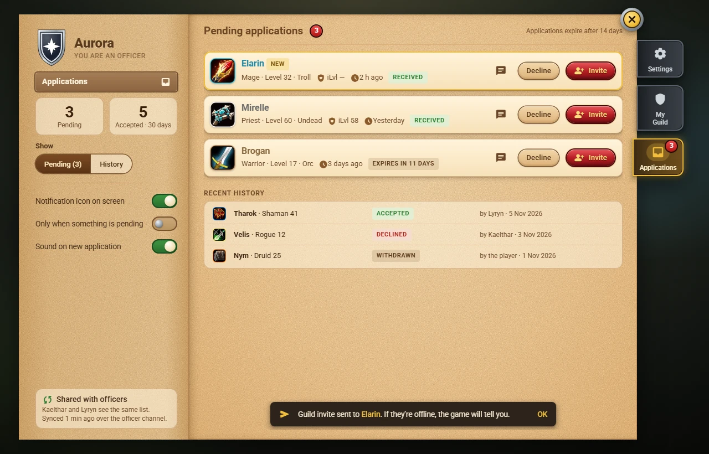
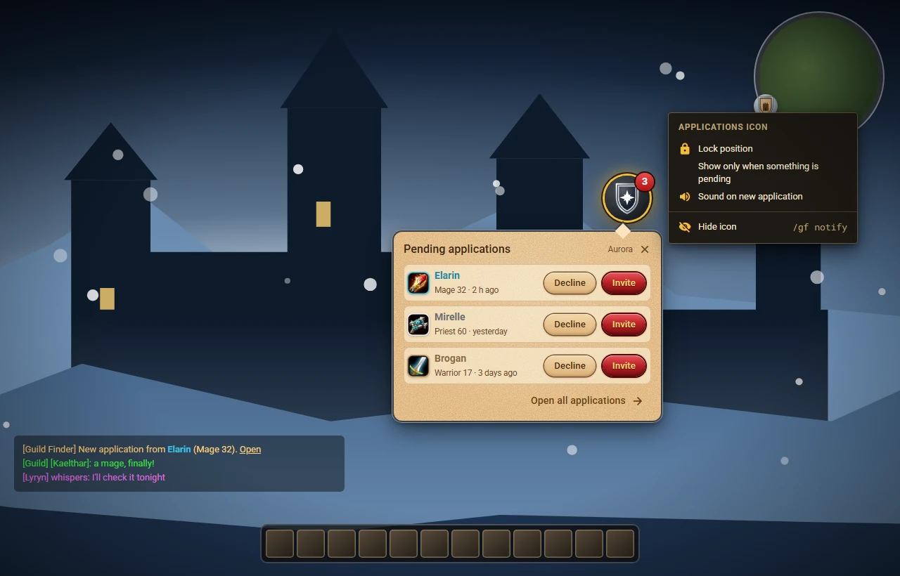

# Managing applications

The Guild Master and the **officers** see the **Applications** tab (in the side rail, under *My Guild*). It exists once your guild has a listing; a plain member never has it.

> **Status:** the panel is written and tested offline; nothing of it has been tried in WoW Forever yet. Since M4.2 the addon of the Guild Master and of every officer **receives** applications by itself while they are online, and since M4.3 the officers' copies **stay in sync** (see below). The floating notification icon comes next.

## The list

On the left: the guild's emblem and your role, two counters (**Pending** and **Accepted · 30 days**), the **Pending (3) / History** switch, the three notification options and a note that the list is shared with the other officers. The tab in the rail carries a red number: the applications waiting for a decision (the same number is in the tooltip of the minimap button, and **My Guild** says how many wait and opens the tab).

**Pending** has one card per application, the newest first:

- the **class icon** in a ring of the class colour, and the **name** in the class colour;
- the **roles** the player ticked (Tank, Healer, Melee DPS, Ranged DPS), if any;
- **level, race** and **item level** (*iLvl —* when the game did not tell), and **how long ago** they applied;
- a **status**: *RECEIVED* for a young application, then *EXPIRES IN 11 DAYS* (amber when 3 days or fewer are left), *INVITING...* while an invite is on its way, and a gold *NEW* with a gold edge for what arrived since you last left the tab.

Scroll with the mouse wheel when there are more than six.

**History** keeps the accepted, declined, withdrawn and expired applications for **30 days**, one line each: *by Lyryn · 5 Nov 2026* (*by the player* when they withdrew, *after 14 days* when it expired). An application withdrawn before it reached you shows only the name.

Only the Guild Master and the officers see the data of an application, and it is only what the player's addon sent: name, class, race, level, item level and the roles they ticked.

## What you can do

- **Invite** sends the normal guild invite of the game (the player must be online). The application becomes *accepted* only when the invite really went out: the game says *You have invited …*, or nothing goes wrong in the next three seconds. If the player is offline the panel says *Name is offline. Try again later.* and the card stays; if the game refuses (already in a guild, no permission to invite) you read its own words.
- If the game does not let the addon send the invite (a protected action; this is still to be checked in the game), **Invite** opens the chat box with `/ginvite Name` already typed: press Enter, and the application is marked accepted when the game confirms; if it does not, press **Mark as invited**. If even the chat box cannot be opened, the panel tells you to invite the player by hand and to mark it afterwards.
- **Decline** asks for confirmation, then the application is declined. The other officers see it within seconds; the player learns it next time they meet an officer online (their addon asks), and cannot apply to your guild again for 7 days.
- **Whisper** opens the chat box with `/w Name` so you can talk to the player first.

Only one officer needs to act: when two officers decide on the same application at the same moment, **Invite wins over Decline** on every copy.

## Notifications

Three options, on the left page of the Applications tab and, for the Guild Master and the officers, in a **Notifications** card of **Settings**:

- **Notification icon on screen**
- **Only when something is pending**
- **Sound on new application**

They are saved for your account. The icon itself (a round metal button with the number of pending applications) comes with the next version; the options are already there.

## How the officers stay in sync

Every officer and the Guild Master keep their **own copy** of the guild's applications, saved on their character. The copies talk to each other over the **officer chat** of the guild (as hidden addon messages: nothing appears in your chat, and plain members never receive them):

- When your addon receives an application, a withdrawal or a decision of yours, it tells the other officers online within a few seconds.
- When you log in, your addon compares its list with the officers who are online and fetches what it missed while you were away; they fetch what only you had. Each missing application comes from **one** officer, so a full inbox is copied in under a minute without flooding the chat.
- If two officers decided differently while they could not see each other, every copy ends the same way: **Invite wins over Decline**, and a closed application (invited, declined, withdrawn, expired) is never reopened.
- An application without a decision **expires after 14 days**; closed ones stay in the history for **30 days**, then they are deleted.
- At most **200** applications per guild are kept: when the list is full the oldest closed one makes room.
- If you **stop being an officer** (or leave the guild), your addon stops receiving them at once and **deletes its copy** a minute after your next login; the tab disappears.

Officers who are never online at the same time still converge: each one passes on what it has to whoever is online next.

## The notification icon

A round metal button with a red badge shows the pending applications. Left click: a quick list with Invite and Decline. Drag: move it. Right click: lock, show only when something is pending, sound, hide. `/gf notify` shows it again. *(Next version.)*
