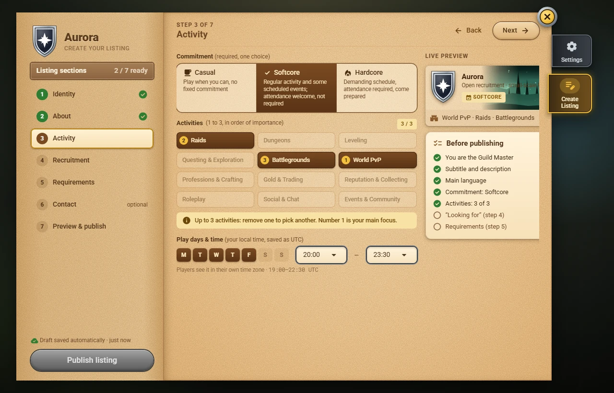
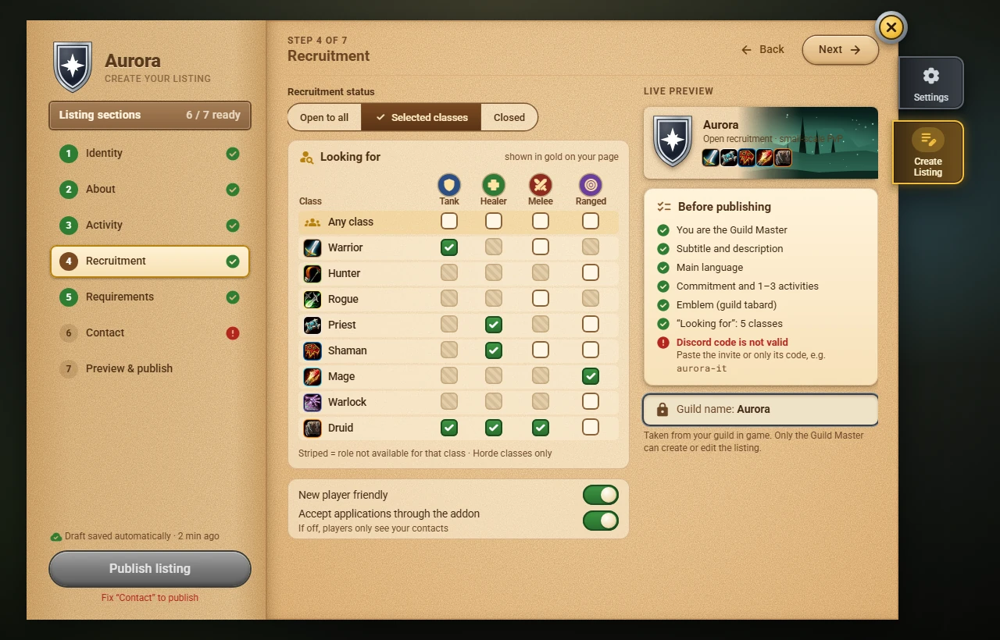

# Publishing a listing

Only the **Guild Master** can publish or edit the guild's listing. Open `/gf`: a Guild Master without a listing sees **Create Listing**.

The editor has seven steps; the left page shows which ones are ready:

1. **Identity**: the guild name (taken from the game), subtitle, [[emblem|Emblems]] and banner.
2. **About**: description and languages.
3. **Activity**: commitment (**Casual**, **Softcore** or **Hardcore**), **up to 3 activities** in order of importance, play days and hours (in your time zone).
4. **Recruitment**: status (open to all, selected classes, closed) and the **Looking for** grid of classes and roles (Tank, Healer, Melee, Ranged); new player friendly; accept applications through the addon.
5. **Requirements**: minimum level, optional item level, a note.
6. **Contact**: the Discord invite code and up to three contact characters.
7. **Preview & publish**: the checklist must be all green.

The draft is saved automatically. After publishing, the listing reaches other players over the next minutes, through every member of your guild who uses the addon. **Delist** removes it.
