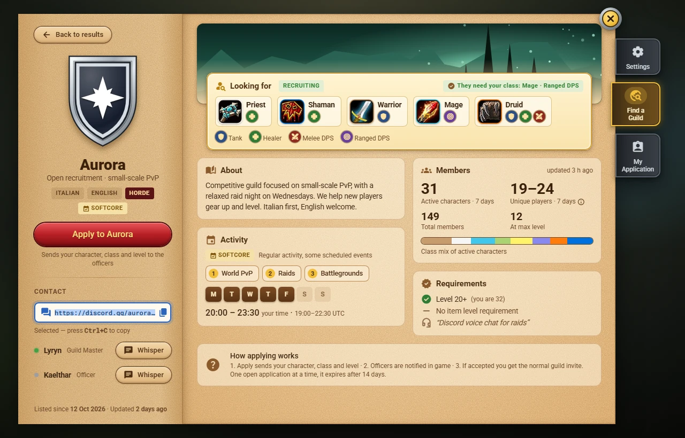

# The guild page

Click a card in [[Finding a Guild|Finding-a-Guild]] to open the page of that guild. It uses both pages of the book. **Back** (the button in the title bar, or the Backspace key) returns to the list exactly as you left it: the same search, filters and place.

## The left page: who they are

- The **emblem** (the guild's tabard or the one its Guild Master designed, see [[Emblems|Emblems]]; a plain shield with the initial when there is none), the **name**, the subtitle and the tags: the **languages** (the main one first), the **faction** and the **commitment**: *Casual* (green), *Softcore* (amber) or *Hardcore* (red). Hover the commitment to read what it means; it is the guild's commitment, not permadeath. *May be inactive* shows when the guild has not announced itself for more than 14 days.
- **Apply to *Guild***, under the tags, with a line that explains it: it applies after a short question, or says why you cannot (requirements, an open application elsewhere, a recent decline...). See [[Applying|Applying]]. A guild that closed applications through the addon has no button and says so: *Applications via addon are closed. Use the contacts below.*
- **Contact**:
  - **Discord**: the invite link, `https://discord.gg/` plus the code the Guild Master gave. The game cannot open web links, so click the field (or its button): the whole link is selected, then press **Ctrl+C** and paste it into your browser.
  - **Contact characters** (up to three): a green dot means the character announced itself recently, so it is probably online. **Whisper** opens the chat box with `/w Name ` ready for you to type.
- At the bottom: *Listed since* (the date of the first listing) and *Updated* (the last change). There is no founding date: the game does not provide a reliable one.

## The right page: the details

- The **banner**, and over it the gold **Looking for** card. It comes first because it is what you came to find out:
  - the **recruiting state**: *Recruiting* (green), *Recruiting: selected classes only* (amber) or *Recruiting closed* (red);
  - a box for each class they look for, with the roles they need from it (Tank, Healer, Melee DPS, Ranged DPS, with the legend underneath), and *Any class* with its roles when they take anyone;
  - a green tag, *They need your class: Mage · Ranged DPS*, when your class is wanted for a role it can play.
- **About**: the guild's own description.
- **Activity**: the commitment, up to three activities in order of importance, the days (seven squares, Monday first) and the hours **in your time zone**, with the guild's UTC hours smaller underneath. *All day* means they play at any hour.
- **Members**: only aggregate numbers, never names.
  - **Active characters**: characters of the guild that played in the last 7 days.
  - **Unique players**: the people behind those characters. When not every member uses the addon it is an estimate shown as a range, for example *19–24* (hover it to read how it is counted); when it is exact it is one number.
  - **Total members** and members **at max level**, a coloured bar with the **class mix** of the active characters, and how old the numbers are (*updated 3 h ago*).
  - The numbers come from the guild's own members: every member who uses the addon counts them from the guild roster and sends them with the guild's announcement, and the newest count wins. On the page of **your own guild** you see your roster's numbers right away. How the unique players are estimated, and how to keep your characters out of it, is in [[Privacy and Data|Privacy-and-Data]].
- **Requirements**: each one checked against **your character**: a green check when you meet it, a red cross when you do not, with your own level or item level next to it (*Level 20+ (you are 32)*). A requirement the game cannot tell the addon (for example your item level) shows without a check or a cross. The Guild Master's note is shown in quotes.
- **How applying works**: the three steps, for someone who has never used the addon.

The right page scrolls with the mouse wheel when it is taller than the window.

## While the details load

The list only carries a short summary of each guild. The **description, the Discord link, the contact characters and the note** are asked from the other players who have them when you open the page, so the page appears at once with everything that comes from the summary and fills the rest in by itself:

| You see | It means |
|---|---|
| *Loading details...* in About and under **Contact** | the addon is asking; the answer usually takes a few seconds |
| *Details unavailable right now (no one who has them is online)* | nobody who has the details answered within 20 seconds. The rest of the page is complete; close and open the page again later |
| *This listing is no longer available. Go back to the list.* | the guild withdrew its listing while you were looking |

## The numbers

- There is no founding date: *Listed since* is the date of the first listing.
- Times and days are converted from UTC to **your computer's time zone**, the same way the list and the filters do it, so the three always agree. A guild that plays late in the evening in UTC may play on the next day in your zone.
